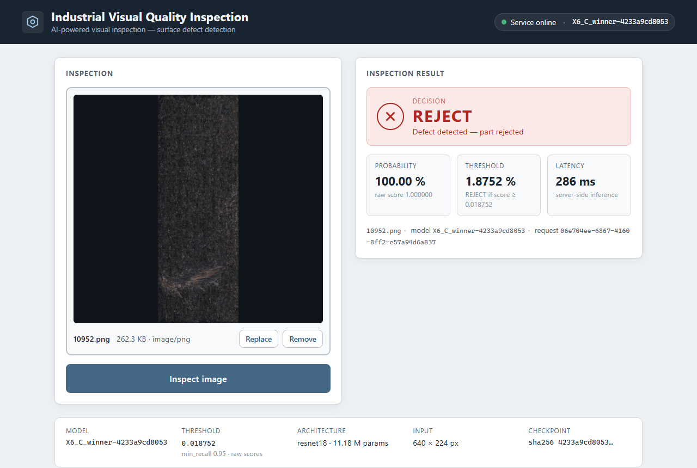

# Industrial Visual Quality Inspection

Pipeline de deep learning pour la détection automatique de défauts de surface sur des pièces industrielles — de la
donnée brute jusqu'à un service d'inférence conteneurisé et appelable.

**État : Phase 4 livrée — modèle final gelé et évalué une seule fois sur le test officiel.** Tous les
chiffres ci-dessous proviennent d'exécutions journalisées (`reports/*/…json`).

| Phase | Contenu | Document |
|---|---|---|
| 0 | Cadrage, choix du dataset, métriques, risques | [docs/00_phase0_framing.md](docs/00_phase0_framing.md) |
| 1 | Ingestion, manifeste, doublons, découpage, EDA | [docs/01_phase1_ingestion.md](docs/01_phase1_ingestion.md) · [rapport EDA](reports/eda/eda_report.md) |
| 2 | Prétraitement OpenCV, comparaison des transformations (CNR), baseline SVM | [docs/02_phase2_preprocessing_baseline.md](docs/02_phase2_preprocessing_baseline.md) · [rapport Phase 2](reports/phase2/phase2_report.md) |
| 3 | Transfert ResNet-18 par étapes, matrice de déséquilibre, comparaison appariée | [docs/03_phase3_training.md](docs/03_phase3_training.md) · [rapport Phase 3](reports/phase3/phase3_report.md) |
| 4 | Vérification, calibration, seuil gelé, évaluation unique du test, erreurs, Grad-CAM | [docs/04_phase4_final_evaluation.md](docs/04_phase4_final_evaluation.md) · [rapport Phase 4](reports/phase4/phase4_report.md) |
| 5 | API d'inférence FastAPI (`/health`, `/model-info`, `/predict`) sur le bundle gelé | [docs/05_phase5_api.md](docs/05_phase5_api.md) |
| 6 | Image Docker CPU non-root (bundle intégré), Compose, CI GitHub Actions (lint, tests, build + smoke test) | [docs/06_phase6_docker_ci.md](docs/06_phase6_docker_ci.md) |
| 7 | Interface web Angular : image → inspect → décision, au-dessus de l'API | [docs/07_phase7_web_interface.md](docs/07_phase7_web_interface.md) |

## Problème

Étant donné l'image d'une pièce, décider **ACCEPT** ou **REJECT**. Les deux erreurs n'ont pas le même coût : un
défaut manqué (faux négatif) expédie une pièce défectueuse ; une fausse alerte (faux positif) ne déclenche qu'une
réinspection humaine. Chaque choix de métrique, de fonction de perte et de seuil dans ce projet est fait sous cette
asymétrie — voir [docs/00_phase0_framing.md](docs/00_phase0_framing.md) §4.

## Jeu de données

KolektorSDD2 (Božič, Tabernik & Skočaj, 2021) : 3 335 images réelles de ligne de production de commutateurs
électriques, ~11 % défectueuses, masques au pixel, découpage train/test officiel. Justification et alternatives
étudiées : [docs/00_phase0_framing.md](docs/00_phase0_framing.md) §1.

Les données ne sont pas versionnées. La reproductibilité repose sur la somme de contrôle de l'archive
(`dataset.archive_sha256`) et sur le manifeste de découpage versionné dans `data/splits/v1.csv`
(train 1 865 / val 466 / test 1 004 images, seed 42, stratifié et group-aware — invariants dans
`v1.meta.json`). Fait notable : l'archive officielle contient une copie accidentelle
(`train/10301 (copy).png`), détectée et exclue via le manifeste sans toucher aux fichiers.

## Pipeline

Archive brute → vérification d'intégrité → manifeste → recherche de doublons → découpage stratifié → prétraitement →
fine-tuning ResNet-18 → choix du seuil sur la validation → évaluation finale unique sur le test → export → FastAPI →
Docker. Schéma et contrats par étape : [docs/pipeline.md](docs/pipeline.md).

## Résultats

Modèle final : ResNet-18 ImageNet fine-tuné (`layer3` + `layer4` + tête), `pos_weight` 8,47, seuil **0,018752**
choisi sur la validation (règle : rappel ≥ 0,95 + marge) et gelé avant tout contact avec le test.

| Jeu | Rôle | AP | ROC-AUC | Rappel au seuil | Précision au seuil | FPR au seuil | TP / FP / FN / TN |
|---|---|---|---|---|---|---|---|
| validation (466, 49 déf.) | développement — modèle et seuil choisis dessus | 0,941 [0,891 ; 0,979] | 0,987 | 0,959 | 0,480 | 0,122 | 47 / 51 / 2 / 366 |
| **test officiel (1 004, 110 déf.)** | **résultat final, évaluation unique** | **0,948 [0,909 ; 0,977]** | 0,979 | **0,955 [0,907 ; 0,991]** | 0,536 | 0,102 | 105 / 91 / **5** / 803 |

Références gelées scorées dans la même passe de test : contraste seul AP 0,384 ; 82 descripteurs + SVM AP 0,814
(précision 0,171 à rappel 0,95) ; étape B seule (X4) AP 0,947 — indissociable du modèle final (ΔAP apparié
+0,001 [−0,022 ; +0,024]). Détails, IC, analyse des erreurs et Grad-CAM : [rapport Phase 4](reports/phase4/phase4_report.md).

## Organisation du dépôt

```
.
├── .github/workflows/  # CI : lint, tests, build Docker + smoke test
├── configs/            # configuration YAML (default.yaml + experiments/)
├── data/               # raw/ interim/ processed/ ignorés par git ; splits/ versionné
├── docs/               # cadrage, pipeline, une note par phase
├── notebooks/          # exploration uniquement ; rien dans le pipeline n'en dépend
├── reports/            # eda/, phase2/, phase3/, phase4/ : rapports Markdown générés + figures + résultats JSON/CSV
├── scripts/            # points d'entrée CLI (une action par script)
├── src/vqi/            # le package (vqi = visual quality inspection)
│   ├── data/           # téléchargement, intégrité, manifeste, doublons, découpage, EDA
│   ├── preprocessing/  # UN module OpenCV partagé par l'entraînement et l'inférence (io, geometry, enhance, pipeline)
│   ├── baseline/       # descripteurs classiques (stats, histogramme, LBP, stats locales) + SVM/RF + rapport
│   ├── evaluation/     # métriques, bootstrap apparié, calibration, seuil, Grad-CAM, évaluation finale
│   ├── models/         # ResNet-18 + tête, gel par groupe, politique BatchNorm
│   ├── training/       # étapes A/B/C, pertes, sampler, dry-run, expériences, rapport
│   ├── inference/      # Predictor : bundle gelé → prétraiter → scorer → décider (test et API)
│   └── api/            # application FastAPI : app (chargement unique), routes, schémas
├── tests/              # dataset synthétique, sans données réelles
├── frontend/           # interface web Angular 21 (src/app : core/services, models, pages/inspection ; e2e/ Playwright)
├── models/final/       # bundle gelé : threshold.json, preprocessor.json, model_card.json (model.pt ignoré par git)
├── runs/               # sorties d'entraînement, ignorées par git
├── logs/               # journaux d'exécution, ignorés par git
├── Dockerfile          # image CPU du service (Python 3.11, non-root, HEALTHCHECK) + .dockerignore en liste blanche
├── compose.yaml        # docker compose up --build
└── requirements-api.txt # dépendances d'exécution de l'API (sous-ensemble épinglé de requirements.txt)
```

## Stack

Python 3.11 · PyTorch / torchvision · OpenCV · scikit-learn · NumPy / pandas · FastAPI / Uvicorn · Docker
(+ matplotlib pour les figures) · Angular 21 / TypeScript pour l'interface web. Machine cible sans GPU CUDA
(tout tourne sur CPU).

## Démarrage

```bash
py -3.11 -m venv .venv && .venv\Scripts\activate
pip install -r requirements.txt && pip install -e ".[train,dev]"
python scripts/download_data.py           # télécharge (853 Mo), vérifie le SHA-256, extrait
python scripts/build_manifest.py          # manifeste + analyse des doublons
python scripts/make_splits.py             # partition train/val/test → data/splits/v1.csv
python scripts/run_eda.py                 # Phase 1 : rapport + figures → reports/eda/
python scripts/compare_preprocessing.py   # Phase 2 : figures + CNR → reports/phase2/
python scripts/run_baseline.py            # Phase 2 : 16 expériences SVM/RF
python scripts/build_phase2_report.py
python scripts/dry_run_training.py        # Phase 3 : mesures CPU avant tout entraînement
python scripts/train.py --only X1_linear_probe X2_B_pw1 X3_B_pw_sqrt_ratio X4_B_pw_ratio X5_B_sampler X6_C_winner
python scripts/build_phase3_report.py
python scripts/verify_checkpoint.py       # Phase 4 : reproduit les scores val du checkpoint
python scripts/select_threshold.py --freeze   # analyse val, calibration, seuil, bundle gelé → models/final/
python scripts/evaluate_test.py           # évaluation UNIQUE du test officiel (+ erreurs, Grad-CAM)
python scripts/build_phase4_report.py
python scripts/serve_api.py               # Phase 5 : API d'inférence sur http://127.0.0.1:8000
pytest
```

## API d'inférence

Le service FastAPI (`src/vqi/api/`) charge **une seule fois** au démarrage le bundle gelé `models/final/` via
`Predictor.from_bundle()` — le même objet que celui de l'évaluation finale — et expose `GET /health`,
`GET /model-info` et `POST /predict`. Documentation Swagger sur `/docs`.

```bash
python scripts/serve_api.py                       # ou : uvicorn vqi.api.app:app --host 0.0.0.0 --port 8000
curl http://127.0.0.1:8000/health                 # {"status":"ok"}
curl -X POST http://127.0.0.1:8000/predict -F "file=@data/raw/kolektor_sdd2/train/10004.png;type=image/png"
```

```json
{"image_id": "10004.png", "probability": 0.016112767159938812, "decision": "ACCEPT",
 "threshold": 0.018752005540198832, "model_version": "X6_C_winner-4233a9cd8053",
 "latency_ms": 328.73, "request_id": "c5fceb66-e85d-4759-9ebd-617572627b83"}
```

`decision = REJECT` ssi `probability >= threshold` (score brut du modèle, non calibré). Entrées invalides :
400 (vide), 413 (> `api.max_upload_mb`), 415 (type non image), 422 (champ absent ou image indécodable).
Latence mesurée côté serveur sur CPU : médiane 256 ms. Détails, formats, journaux et limites :
[docs/05_phase5_api.md](docs/05_phase5_api.md).

## Web Interface

Interface Angular minimaliste (`frontend/`) au-dessus de l'API : **image → Inspect → décision**. Elle n'embarque
aucune logique ML — score, seuil, décision, latence et métadonnées du modèle sont affichés tels que renvoyés par
FastAPI (`/model-info`, `/predict`).

```
Angular → FastAPI → Predictor → X6
```



```bash
python scripts/serve_api.py          # ou docker compose up --build  → http://127.0.0.1:8000
cd frontend && npm install && npm start   # → http://localhost:4200 (Node 22 ; npx npm@11 install si npm 10.9 échoue)
npm test                              # 26 tests unitaires (vitest + jsdom, sans API)
npm run e2e                           # bout en bout Chrome → Angular → API, images de validation 10004 / 10045 / 10952
```

Exemple : déposer `data/raw/kolektor_sdd2/train/10952.png` (validation, défectueuse) → **REJECT**, probabilité
100.00 %, seuil 1.8752 %, latence affichée = `latency_ms` de l'API. URL de l'API dans
`frontend/src/environments/environment*.ts` ; origines autorisées (CORS) dans `api.cors_origins` de
[configs/default.yaml](configs/default.yaml). Détails : [docs/07_phase7_web_interface.md](docs/07_phase7_web_interface.md).

## Docker

Image CPU (`python:3.11.9-slim-bookworm`, utilisateur non-root `app`) contenant le bundle gelé `models/final/`
— le `model.pt` étant ignoré par git, il faut disposer du bundle localement (sinon `--build-arg REQUIRE_MODEL=0`
et un bundle monté via `VQI_BUNDLE_DIR`).

```bash
docker build -t vqi-api .                        # ~7 min à froid, 1,86 Go (PyTorch CPU)
docker run --rm -p 8000:8000 vqi-api             # ou : docker compose up --build
curl http://127.0.0.1:8000/health                # {"status":"ok"}  (= processus vivant ET modèle chargé)
# Swagger : http://127.0.0.1:8000/docs
bash scripts/docker_smoke_test.sh vqi-api real   # /health, /model-info (SHA-256 + seuil = models/final/), HEALTHCHECK
```

## CI

[.github/workflows/ci.yml](.github/workflows/ci.yml), à chaque push / pull request, sans GPU, sans données,
sans secret : `lint` (`ruff check .`, `ruff format --check .`), `tests` (`pytest` sur données et bundle
synthétiques ; le test lisant le bundle réel est sauté), `docker` (`docker build` de l'image applicative
puis smoke test : bundle synthétique généré dans l'image, `/health`, `/model-info`, `/predict`, `HEALTHCHECK`).
Aucune image n'est poussée vers un registre. Détails : [docs/06_phase6_docker_ci.md](docs/06_phase6_docker_ci.md).

## Reproductibilité

Graine `42` partout (`reproducibility.seed` dans [configs/default.yaml](configs/default.yaml)), algorithmes torch
déterministes quand ils existent, workers de DataLoader seedés, configuration figée et hash git enregistrés avec
chaque artefact (`*.meta.json`, un JSON par expérience). Le non-déterminisme résiduel sur CPU est documenté dans le
cadrage (risque R9).
