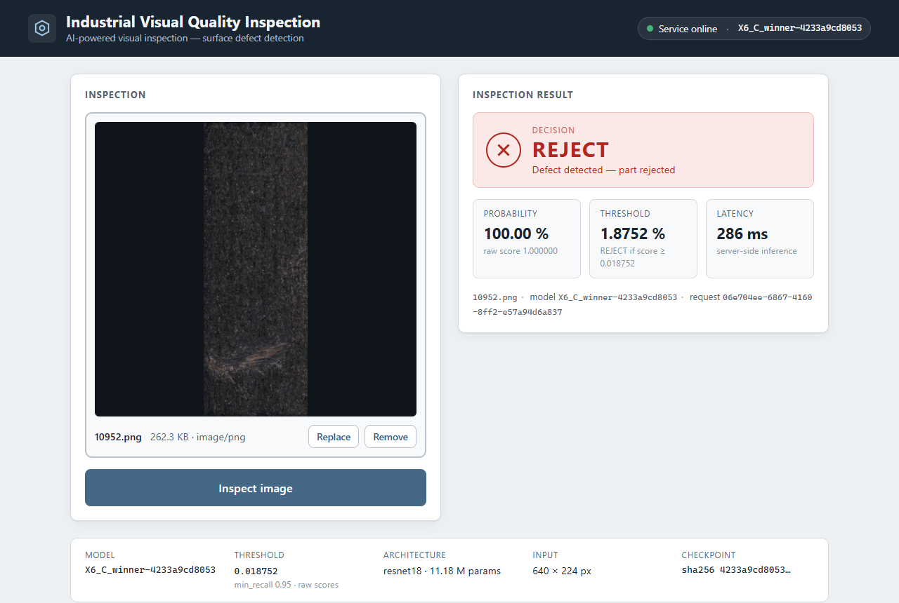

# Phase 7 — Interface web Angular

**État : livrée le 18/09/2026.** Une couche frontend minimaliste au-dessus de l'API de la Phase 5 : l'utilisateur
dépose une image, lance l'inspection et lit la décision. Aucune logique ML côté navigateur : le score, le seuil,
la décision, la latence et les métadonnées du modèle sont **affichés tels que reçus** de FastAPI. Modèle, seuil,
prétraitement, `Predictor` et résultats de Phase 4 inchangés. Chaque chiffre cité provient d'une exécution réelle
(tests unitaires, tests de bout en bout Playwright, journaux d'exécution locaux `logs/`, non versionnés).



## 7.1 Objectif

Rendre le système d'inspection utilisable visuellement, sans dashboard ni fonctionnalité annexe :

```
IMAGE  →  INSPECT  →  DECISION
```

## 7.2 Architecture

```
navigateur (Chrome, Edge, …)
   │  http://localhost:4200
   ▼
Angular 21 (frontend/)              GET /model-info  ──▶  métadonnées du modèle (version, seuil, SHA-256, …)
   InspectionPage ── InspectionService ── POST /predict (multipart, champ `file`) ──▶ FastAPI (:8000)
                                                                                          │
                                                                                     Predictor.from_bundle()
                                                                                          │
                                                                                 modèle X6 gelé + seuil 0,018752
                                                                                          │
   affichage ◀── {image_id, probability, decision, threshold, model_version, latency_ms, request_id}
```

| Fichier (`frontend/src/app/`) | Rôle |
|---|---|
| `models/inspection.models.ts` | interfaces TypeScript **miroir exact** de `src/vqi/api/schemas.py` (`HealthResponse`, `ThresholdInfo`, `ModelInfoResponse`, `PredictionResponse`, `ErrorResponse`) + `InspectionError` (type d'erreur affiché) |
| `models/app-environment.ts` | forme de la configuration (`apiBaseUrl`, `maxUploadMb`, `allowedTypes`) |
| `core/services/inspection.service.ts` | seul point d'accès HTTP : `health()`, `modelInfo()`, `predict(file)` (`HttpClient`, `FormData`, aucun `Content-Type` manuel) |
| `core/api-error.ts` | `describeHttpError()` : statut HTTP → message utilisateur (jamais de traceback) |
| `pages/inspection/inspection-page.{ts,html,css}` | la page : dépôt/sélection, aperçu, bouton *Inspect image*, résultat, bandeau modèle ; état par *signals*, `OnPush`, zoneless |
| `app.ts`, `app.config.ts` | coquille (`provideHttpClient()`), pas de routeur |
| `../environments/environment*.ts` | URL de l'API et limites côté client |

Stack : Angular **21.2.24** (CLI 21.2.24, `@angular/build`), TypeScript 5.9, tests unitaires **vitest 4.1 + jsdom**
(builder `@angular/build:unit-test`), Prettier, Playwright 1.63 pour le bout en bout (navigateur Chrome installé,
aucun téléchargement). Node 22.14 (Angular 22 exigerait Node ≥ 22.22 : la version 21 est la plus récente compatible
avec l'environnement). Aucune bibliothèque UI, aucun store, aucun WebSocket, aucune base de données.

## 7.3 Fonctionnalités

| Fonction | Comportement |
|---|---|
| Sélection | bouton *Choose image* (input fichier accessible) ou glisser-déposer sur la zone ; PNG, JPEG, BMP |
| Validation côté client | type MIME hors liste → message ; fichier vide → message ; taille > `maxUploadMb` (10 Mo) → message ; **pré-contrôle seulement**, l'API reste l'autorité (400/413/415/422) |
| Aperçu | `URL.createObjectURL(file)`, proportions conservées (`object-fit: contain`), nom, taille, type ; boutons *Replace* / *Remove* ; l'image n'est **jamais** modifiée ni redimensionnée côté client (le prétraitement appartient au backend) |
| Inspection | bouton désactivé sans image ; pendant l'appel : *Inspecting…*, `aria-busy`, bouton désactivé, requêtes concurrentes ignorées |
| Résultat | décision `ACCEPT` / `REJECT` (texte + icône ✓/✕ + couleur, jamais la couleur seule), probabilité `1.61 %` + score brut à 6 décimales, seuil `1.8752 %` + règle « `REJECT` if score ≥ 0.018752 », latence `266 ms` (valeur `latency_ms` de la réponse), `image_id`, `model_version`, `request_id` |
| Modèle | bandeau alimenté par `/model-info` : version, seuil (valeur, politique, calibration), architecture et nombre de paramètres, taille d'entrée, SHA-256 du checkpoint ; pastille *Service online / unavailable* avec *Retry* |
| Accessibilité | `<h1>`/`<h2>`, sections `aria-labelledby`, `aria-live="polite"` sur le résultat, `role="alert"` sur les erreurs, `role="status"` sur l'état du service, `alt` sur l'aperçu, focus visible (`:focus-visible`), navigation clavier (boutons natifs), contrastes AA sur fond clair |
| Responsive | grille 2 colonnes ≥ 1024 px, 1 colonne en dessous ; métriques en colonne < 600 px ; vérifié sans défilement horizontal à 1440 / 1024 / 768 / 390 px (test Playwright) |

**Aucune logique ML** : la décision affichée est `response.decision` ; le libellé de la classe « défaut » vient de
`decision_labels.positive` de `/model-info` ; le seuil affiché est `response.threshold` ; rien n'est comparé côté
client. Un test unitaire envoie volontairement une réponse incohérente (`probability 0.9`, `threshold 0.25`,
`decision ACCEPT`) et vérifie que la page affiche `ACCEPT` et `25.0000 %` tels quels.

## 7.4 Lancement

```bash
# 1. l'API (l'un ou l'autre)
python scripts/serve_api.py                 # http://127.0.0.1:8000
docker compose up --build                   # idem, dans le conteneur (image reconstruite avec CORS)

# 2. l'interface
cd frontend
npm install                                 # première fois (Node 22 ; npm ≥ 11 si npm 10.9 échoue, voir § 7.8)
npm start                                   # http://localhost:4200
```

Build de production : `npm run build` → `frontend/dist/frontend/browser/` (fichiers statiques à servir par n'importe
quel serveur HTTP ; 167,6 kB initial, 49 kB transférés).

## 7.5 Configuration de l'API

`frontend/src/environments/environment.ts` (production) et `environment.development.ts` (`ng serve`, `ng test`) :

```ts
export const environment: AppEnvironment = {
  production: false,
  apiBaseUrl: 'http://127.0.0.1:8000',   // où joindre FastAPI
  maxUploadMb: 10,                        // miroir de api.max_upload_mb (pré-contrôle)
  allowedTypes: ['image/png', 'image/jpeg', 'image/bmp'],  // miroir de api.allowed_content_types
};
```

`angular.json` remplace `environment.ts` par `environment.development.ts` en configuration `development`
(`fileReplacements`). Aucune URL n'est codée en dur ailleurs ; le service lit `environment.apiBaseUrl`.

### CORS (seule modification de l'API)

Test réel navigateur → FastAPI **avant** correctif (Chrome piloté par Playwright, API sans CORS) :

```
Access to XMLHttpRequest at 'http://127.0.0.1:8000/model-info' from origin 'http://localhost:4200'
has been blocked by CORS policy: No 'Access-Control-Allow-Origin' header is present on the requested resource.
```

(`curl -H "Origin: http://localhost:4200"` confirmait l'absence de l'en-tête ; `OPTIONS /predict` répondait 405.)
Correctif minimal : `api.cors_origins` dans `configs/default.yaml` (liste **explicite**
`http://localhost:4200`, `http://127.0.0.1:4200` ; liste vide = pas de CORS), `CORSMiddleware` ajouté dans
`create_app` **uniquement** si la liste est non vide, méthodes `GET`/`POST`, en-tête `X-Request-ID` autorisé et
exposé, pas de `*`, pas de credentials. Le handler 500 (qui s'exécute hors du middleware) ajoute lui-même
`Access-Control-Allow-Origin` pour une origine autorisée, sinon le navigateur verrait une erreur réseau au lieu
d'un 500 propre. Le contrat d'inférence est inchangé. Tests ajoutés (`tests/test_api.py`) : origine autorisée →
en-tête présent ; origine inconnue → absent ; preflight `OPTIONS` → 200 ; liste vide → aucun en-tête ; 500 →
en-tête conservé. Après correctif, le même test navigateur passe sans aucune erreur console.

## 7.6 Gestion des erreurs

| Situation | Détection | Message affiché |
|---|---|---|
| service injoignable (arrêté, CORS, réseau) | `HttpErrorResponse.status === 0` | « Unable to connect to the inspection service. Please verify that the API is running. » + URL attendue et commandes de démarrage ; pastille *Service unavailable* + *Retry* |
| fichier refusé par l'API (400 vide, 413 trop gros, 415 type, 422 indécodable) | statut 4xx | « The image was rejected by the service: `<detail>`. » — `detail` est le message court de l'API |
| modèle non chargé | 503 | « The inspection service is running but its model is not loaded. Please retry later. » |
| erreur interne | 500 / autre | « The inspection service reported an internal error (HTTP 500). Please retry. » + `request_id` ; **jamais** de traceback (l'API n'en envoie pas non plus) |
| fichier invalide côté client | avant tout appel | type non supporté / fichier vide / trop volumineux |

Après une erreur, l'image reste sélectionnée et *Inspect image* redevient actif (nouvel essai possible).

## 7.7 Tests

### Unitaires (`npm test`, vitest + jsdom, sans Docker ni API) — **26 tests, 26 passés**

- `inspection.service.spec.ts` (10) : `GET /health`, `GET /model-info` (payload intact), `POST /predict`
  (`FormData` avec le champ `file`, **aucun** en-tête `Content-Type` manuel) via `HttpTestingController` ;
  `describeHttpError` : statut 0, 415 avec `detail`, 422 sans corps exploitable, 503, 500 (message générique,
  `request_id`, pas de traceback), erreur non HTTP.
- `inspection-page.spec.ts` (16) : création et état initial (*No image selected.*, bouton désactivé) ; informations
  modèle affichées depuis `/model-info` (version `SYN-…`, seuil `0.250000` — valeurs de test différentes du réel,
  preuve qu'il n'y a pas de valeur codée en dur) ; sélection PNG → aperçu, nom, taille, bouton actif ; type non
  supporté / trop gros / vide → messages, aucun appel ; dépôt (drop) ; *Remove* ; état de chargement (libellé,
  `disabled`, `aria-busy`, une seule requête malgré un second clic) ; affichage `ACCEPT` (`1.61 %`, `data-raw`
  `0.016112767159938812`, `1.8752 %`, `133 ms`) ; affichage `REJECT` (texte + icône) ; réponse incohérente affichée
  telle quelle ; 422 avec `detail` et `request_id` ; 500 sans traceback ; statut 0 → service indisponible ;
  `/model-info` en échec puis *Retry*.
- `app.spec.ts` (1) : rendu de la page.

`npm run build` : succès, 167,6 kB initial (49,1 kB transférés), aucun avertissement de budget (le CSS de la page
fait 4,1 kB, sous le budget de 4 kB → les styles d'en-tête/pied ont été placés dans `styles.css`). Prettier :
conforme.

### Bout en bout réel (`npm run e2e`, Playwright + Chrome installé, API locale démarrée) — **6 tests, 6 passés**

Images de **validation** uniquement (`split == "val"` de `data/splits/v1.csv`), jamais le test officiel. Pour chaque
image, la page envoie le fichier, puis le test envoie **les mêmes octets** directement à `POST /predict` et compare
les valeurs brutes exposées par la page (`data-raw`) à la réponse JSON :

| Image (val) | Interface | API (même fichier) | Égalité brute |
|---|---|---|---|
| `10004.png` (saine) | **ACCEPT** · 1.61 % (raw `0.016112767159938812`) · seuil 1.8752 % · 352 ms | ACCEPT · `0.016112767159938812` · `0.018752005540198832` | ✔ |
| `10045.png` (défaut 23 px, **faux négatif connu**) | **ACCEPT** · 1.78 % (raw `0.017811179161071777`) · 324 ms | ACCEPT · `0.017811179161071777` | ✔ (comportement reproduit, pas « corrigé ») |
| `10952.png` (défaut 14 727 px) | **REJECT** · 100.00 % (raw `1`) · 283 ms | REJECT · `1` | ✔ |

Ces trois scores sont aussi ceux de `reports/phase4/val_scores.csv` (Phases 5 et 6). Les latences affichées sont
celles renvoyées par l'API à chaque requête (elles varient d'un appel à l'autre : 250–350 ms sur l'API locale
Windows).

Autres vérifications de bout en bout : `/model-info` affiché sans erreur console (preuve CORS) ; fichier texte
refusé côté client ; faux PNG → 422 de l'API affiché ; **aucun défilement horizontal** à 1440, 1024, 768 et 390 px
avec un résultat affiché (captures `frontend/e2e/screenshots/`, ignorées par git ; deux captures conservées dans
`docs/figures/phase7_web_interface_{reject,accept}.png`).

Le job CI GitHub Actions `frontend` (`npm ci`, Prettier, `ng test`, `ng build`) a été rejoué sous Linux dans un
conteneur `node:22-bookworm` (§ 7.9), puis exécuté réellement sur GitHub Actions au premier push : succès en 19 s. Le bout en bout n'est pas en CI (il exige l'API, le bundle réel
et les données).

## 7.8 Problèmes rencontrés

- `npm install` échouait avec npm 10.9.2 (`Cannot read properties of null (reading 'edgesOut')`, bogue connu de
  l'arborist avec les *peer dependencies* de vitest 4) → installation avec `npx npm@11 install` ; le `package-lock.json`
  produit est versionné.
- Dans jsdom, `FormData.get('file')` renvoie une **copie** du `File` : le test compare nom et type, pas l'identité.
- `python3` dans Git Bash est l'alias du Microsoft Store : les scripts Node utilisent `node` directement.
- CORS (§ 7.5) : seule modification de l'API.

## 7.9 Résultats de validation technique

| Vérification | Résultat |
|---|---|
| `npm test` (vitest, jsdom) | 26 passés / 26 |
| `npm run build` (production) | succès, 167,6 kB initial, 0 avertissement |
| `npm run format:check` (Prettier) | conforme |
| `npm run e2e` (Chrome réel, API locale) | 6 passés / 6 |
| `pytest` (backend, CORS inclus) | 105 passés / 105 (102 + 3 tests CORS) |
| `ruff check .` / `ruff format --check .` | propres |
| job CI `frontend` rejoué sous Linux (`node:22-bookworm`, Node 22.23 / npm 10.9.8) | succès : `npm ci`, Prettier, 26 tests, build |
| modèle / seuil | `model.pt` SHA-256 `4233a9cd80534b8e…`, `threshold.json` 0,018752 `frozen`, `git diff` vide sur `models/`, `reports/` |

## 7.10 Limites

- **Interface locale** : `ng serve` (ou un serveur statique) sur la même machine que l'API ; URL de l'API fixée
  à la compilation (`environment.ts`).
- **Pas d'authentification, pas de TLS, pas de limitation de débit** (héritées des Phases 5–6).
- **Pas d'historique persistant, pas de multi-utilisateur** : chaque inspection remplace la précédente ; rien
  n'est stocké (ni base de données, ni `localStorage`).
- **Une image à la fois**, pas de lot, pas de comparaison côte à côte.
- **Pas de déploiement cloud**, pas d'image Docker du frontend (le `Dockerfile` ne contient que l'API).
- Le score reste un **score brut non calibré** (Phase 4) : l'interface le nomme *Probability* pour suivre le
  contrat de l'API et affiche la valeur brute à côté.
- CORS limité aux origines de développement (`localhost:4200`, `127.0.0.1:4200`) : toute autre origine doit être
  ajoutée à `api.cors_origins`.
