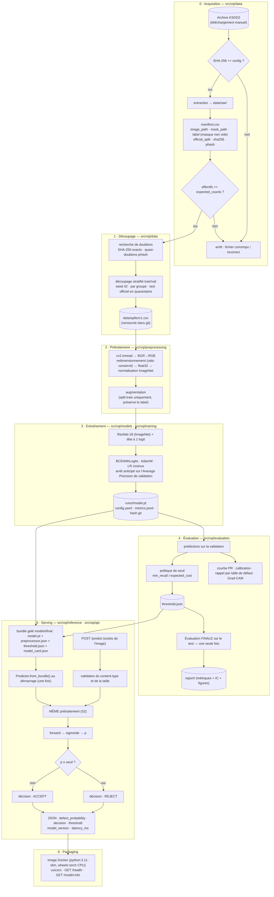

# Pipeline de bout en bout — de l'image brute à la réponse de l'API

Une règle gouverne tout le schéma : **le code de prétraitement utilisé à l'inférence est le même objet que celui
utilisé à l'entraînement** (`src/vqi/preprocessing`). Tout le reste est une dérive entraînement/serving.

## Contrats par étape

| Étape | Entrée | Sortie (artefact) | Module | Déterministe ? |
|---|---|---|---|---|
| 0 Acquisition | archive + `dataset.archive_sha256` | `data/raw/`, `data/interim/manifest.csv` | `vqi.data.download`, `vqi.data.manifest` | oui (conditionné par la somme de contrôle) |
| 1 Découpage | manifeste, `split.*`, `reproducibility.seed` | `data/splits/v1.csv` (versionné) | `vqi.data.splits` | oui (seedé) |
| 2 Prétraitement | chemin d'image ou octets, `preprocessing.*` | `torch.Tensor` [C, H, W] | `vqi.preprocessing.transforms` | oui (augmentation seedée, train uniquement) |
| 3 Entraînement | csv de split, `model.*`, `training.*` | `runs/<id>/model.pt`, `metrics.jsonl`, `config.yaml` figée | `vqi.models.factory`, `vqi.training.loop` | au mieux sur CPU (voir risque R9) |
| 4 Évaluation | checkpoint, csv de split, `evaluation.*` | `threshold.json`, `report/` | `vqi.evaluation.*` | oui (bootstrap seedé) |
| 5 Serving | bundle exporté, `api.*` | JSON HTTP | `vqi.inference.predictor`, `vqi.api.app` | oui |
| 6 Packaging | dépôt + bundle exporté | image Docker | `Dockerfile` | oui (dépendances épinglées) |

## Contrat de l'API (v1, tel que livré en Phase 5)

| Endpoint | Requête | Réponse |
|---|---|---|
| `GET /health` | — | `{"status": "ok"}` |
| `GET /model-info` | — | `{"model_version", "model", "experiment_id", "architecture", "model_sha256", "preprocessor", "threshold": {value, policy, target_recall, margin, selected_on, calibration, frozen_at}, "decision_labels", "project_version", "bundle_frozen_at", "validation_summary", "final_test_summary"}` |
| `POST /predict` | `multipart/form-data`, champ `file` (png/jpeg/bmp, ≤ `api.max_upload_mb`) | `{"image_id": str, "probability": float, "decision": "ACCEPT" \| "REJECT", "threshold": float, "model_version": str, "latency_ms": float, "request_id": str}` |

Cas d'erreur : fichier vide → 400 ; fichier trop volumineux → 413 ; content-type non supporté → 415 ; champ absent
ou image non décodable → 422 ; modèle non chargé → 503 ; erreur interne → 500 sans traceback. Écarts par rapport
au contrat esquissé en Phase 0 : le champ `defect_probability` s'appelle `probability` (score brut, non calibré),
`image_id` et `request_id` ont été ajoutés pour la traçabilité, `/model-info` expose l'intégralité des
métadonnées du bundle gelé (`models/final/`) plutôt qu'un résumé, et le bundle est un `state_dict` PyTorch
(`model.pt`) et non un export TorchScript (décision de Phase 4). Détails : `docs/05_phase5_api.md`.

## Où vit chaque garde-fou anti-fuite

| Garde-fou | Emplacement |
|---|---|
| Somme de contrôle + effectifs attendus | étape 0, échoue bruyamment |
| Doublons exacts / quasi-doublons dans le même split | étape 1 |
| Jeu de test intouché jusqu'à la fin | étape 4 : le script de test exige un `threshold.json` existant produit depuis la validation |
| Masques jamais vus par le classifieur | le `Dataset` de l'étape 2 ne lit que les images ; les masques ne sont lus qu'à l'étape 4 |
| Prétraitement identique entraînement / serving | l'étape 2 est importée par les étapes 3 et 5 ; un test de contrat compare les tenseurs |
