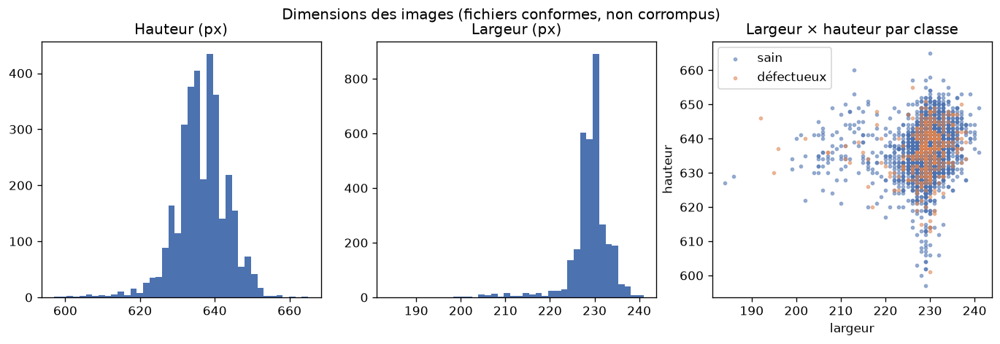
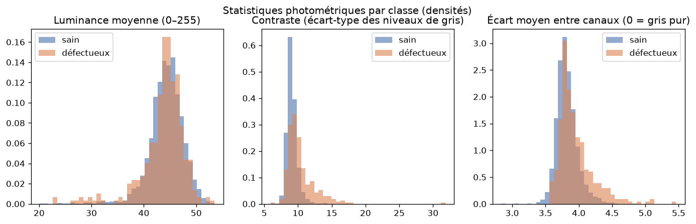
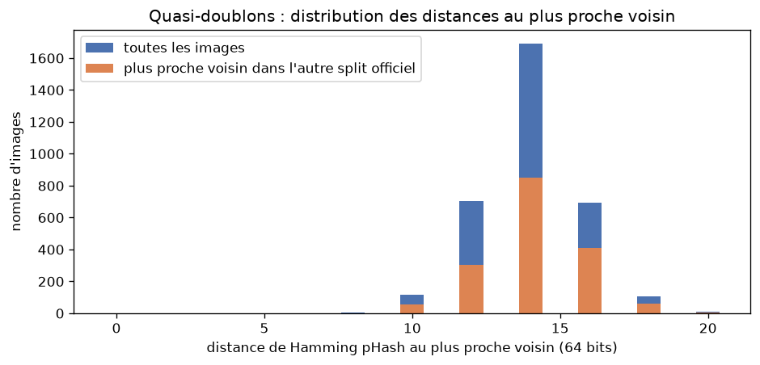
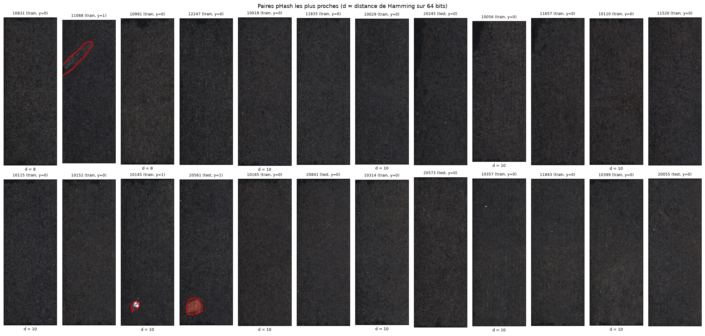
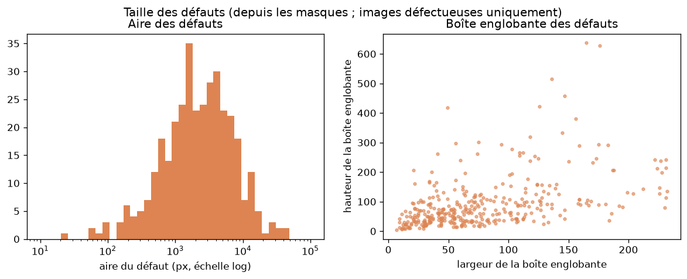
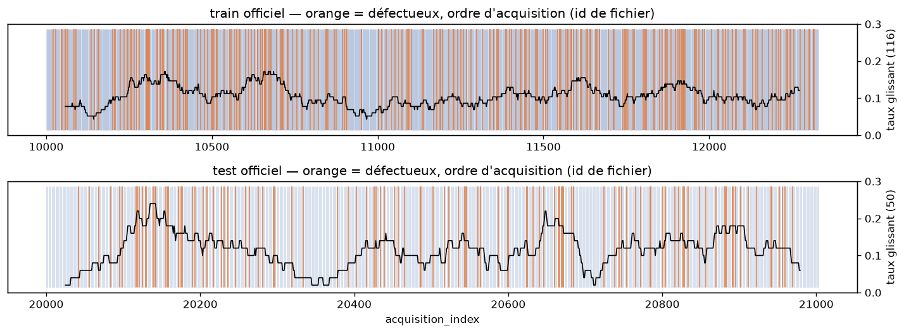
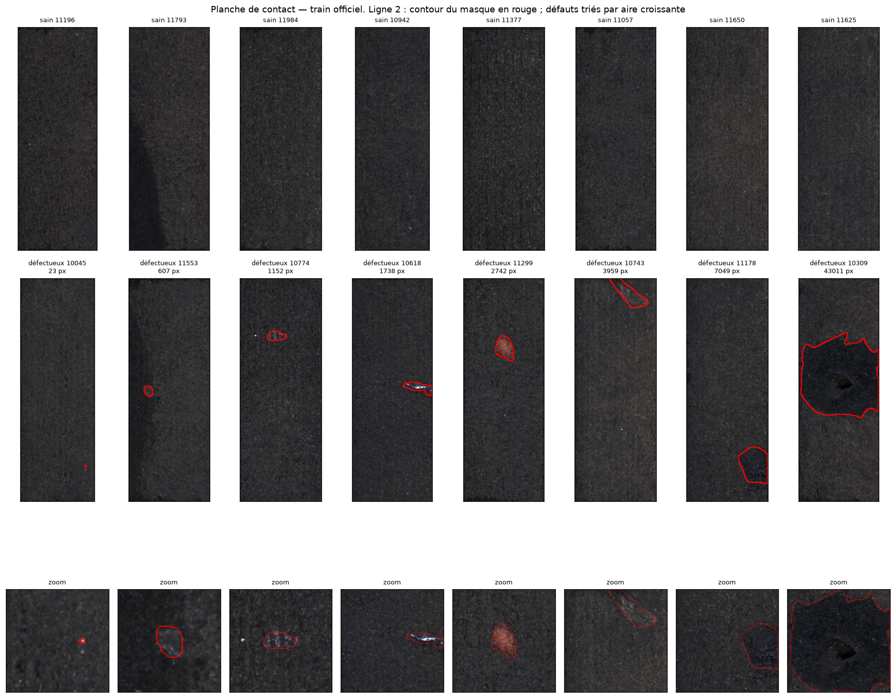

# Analyse exploratoire — kolektor_sdd2

Généré automatiquement par `scripts/run_eda.py` le 2026-09-15
(config `93d115c00aaa`, commit `hors dépôt`).
Chaque chiffre provient du manifeste `data/interim/manifest.csv`
(SHA-256 `e93e299e4e33…`) ; rien n'est saisi à la main.

## 1. Intégrité et inventaire

| Contrôle | Résultat |
|---|---|
| Archive `KolektorSDD2.zip` | SHA-256 `edcdb486809b24f1…` vérifié |
| Fichiers image inventoriés | 3336 |
| Fichiers hors convention de nommage (`^[0-9]+$`) | 1 : `data/raw/kolektor_sdd2/train/10301 (copy).png` |
| Fichiers parasites (masques orphelins) | 1 : `data/raw/kolektor_sdd2/train/10301_GT (copy).png` |
| Images corrompues (non décodables, masque absent ou de taille différente) | 0 |
| Effectifs attendus (article / page officielle) vs observés | **conformes** — {'train_total': 2331, 'train_defective': 246, 'test_total': 1004, 'test_defective': 110} |

Les fichiers hors convention et parasites sont des **copies byte-identiques** laissées dans
l'archive par les auteurs (voir §5) ; ils sont inventoriés, exclus par le manifeste et jamais
supprimés de `data/raw/`.

## 2. Effectifs par classe et déséquilibre

| official_split | n_images | n_good | n_defective | defect_rate | imbalance_ratio_neg_pos |
|---|---|---|---|---|---|
| train | 2331 | 2085 | 246 | 0.1055 | 8.48 |
| test | 1004 | 894 | 110 | 0.1096 | 8.13 |
| all | 3335 | 2979 | 356 | 0.1067 | 8.37 |

Le taux de défaut est de 10,5 % en train officiel et
11,0 % en test officiel : le déséquilibre est le même des
deux côtés, ce qui est cohérent avec un découpage aléatoire par les auteurs. Un modèle qui prédit
« sain » partout obtiendrait 89,0 % d'exactitude sur le
test en manquant 100 % des défauts — c'est pour cela que l'exactitude n'est pas une métrique de ce
projet (cadrage §4.1).

### Options pour répondre au déséquilibre (aucune n'est tranchée ici — Phase 3)

Sur le train officiel : 2085 saines / 246 défectueuses,
soit un ratio de 8,48 : 1.

| option | parametre | valeur | effet_sur_le_gradient | effet_sur_la_calibration |
|---|---|---|---|---|
| aucune (BCE simple) + seuil sur la validation | pos_weight = 1 | 1.0 | aucun ; la classe positive pèse ~10.6 % des exemples | aucun (probabilités interprétables) |
| pondération de la perte (BCEWithLogits pos_weight) | pos_weight = n_neg / n_pos | 8.48 | chaque positif compte comme 8.5 négatifs ; classes équilibrées | décale le prior : les probabilités sont gonflées |
| pondération de la perte, variante douce | pos_weight = sqrt(n_neg / n_pos) | 2.91 | compromis entre les deux précédents | décalage modéré |
| suréchantillonnage des positifs (duplication) | facteur = n_neg / n_pos | 8.48 | équivalent à pos_weight en espérance, mais plus de passes sur les mêmes 246 positifs (risque de surapprentissage) | identique à pos_weight |
| WeightedRandomSampler (tirage équilibré par batch) | poids_i = 1 / n_classe(i) ; batch ≈ 50/50 | 0.004065 | chaque batch contient ~50 % de positifs ; l'epoch ne voit plus tous les négatifs | décalage du prior (comme pos_weight) |
| focal loss | gamma = 2 (config training.loss.focal_gamma) | 2.0 | atténue les exemples faciles, quelle que soit leur classe | connue pour dégrader la calibration |

Points de comparaison pour la décision :

- **Le levier des coûts reste le seuil** (cadrage §4.3) : aucune de ces options ne remplace le
  choix du point de fonctionnement sur la validation ; elles agissent sur l'apprentissage, pas
  sur la décision.
- `pos_weight`, le suréchantillonnage et le `WeightedRandomSampler` sont trois façons d'obtenir
  le même rééquilibrage en espérance ; ils diffèrent par la variance du gradient et par le
  nombre de passes sur les 246 positifs.
- Un ratio de 8,5 : 1 est *modéré* : la BCE non pondérée
  converge généralement sans intervention à ce niveau, ce qui rend l'option « aucune » crédible
  comme référence ; l'ablation `pos_weight ∈ {1 ; 2,9 ; 8,5}` prévue en Phase 4 tranchera sur des chiffres.
- Toute option qui rééquilibre décale les probabilités ; si la politique de seuil `expected_cost`
  est retenue, une recalibration (temperature scaling) devient nécessaire.

## 3. Dimensions et canaux

| Statistique | Hauteur (px) | Largeur (px) |
|---|---|---|
| min | 597 | 184 |
| médiane | 637 | 229 |
| max | 665 | 241 |
| valeurs distinctes | 59 | 47 |

Ratio hauteur/largeur médian : 2,77. Les dimensions
varient d'une image à l'autre (601 combinaisons distinctes) :
le prétraitement doit donc normaliser la taille. La cible de la config
(640×224, H×W) est à l'échelle
native médiane (637×229) : il n'y a pratiquement
pas de sous-échantillonnage, donc pas de perte des petits défauts (décision D7 confirmée).

Canaux : {3: 3335} (tous les fichiers ont 3 canaux).
Écart moyen entre canaux : médiane 3,81/255,
max 5,46/255 → les images sont **quasi monochromes**
(légère dominante colorée). Conséquence pour `preprocessing.color_mode` : `rgb` ne coûte rien avec un
backbone pré-entraîné (qui attend 3 canaux) et conserve la faible information couleur ; `grayscale`
répliqué sur 3 canaux serait équivalent à ~3,8/255 près.
Recommandation : garder `rgb`.

## 4. Luminosité et contraste

| Classe | Luminance moyenne (médiane) | Contraste = écart-type (médiane) |
|---|---|---|
| sain | 44,5 | 9,0 |
| défectueux | 44,4 | 9,7 |

Les images sont sombres (luminance ≈ 44,5/255) et à faible
contraste : l'augmentation luminosité/contraste devra rester légère pour ne pas sortir du domaine.

### Séparabilité triviale (biais à connaître)

ROC-AUC d'une statistique globale utilisée seule comme score de défaut, sur le train officiel :

| feature | roc_auc | auc_from_0.5 |
|---|---|---|
| std_luminance | 0.7246 | 0.2246 |
| channel_spread | 0.6442 | 0.1442 |
| mean_luminance | 0.4753 | 0.0247 |
| width | 0.5156 | 0.0156 |
| height | 0.5142 | 0.0142 |
| image_bytes | 0.5023 | 0.0023 |

Lecture : les statistiques les plus prédictives sont `std_luminance` (AUC 72,5 %) et `channel_spread` (AUC 64,4 %) — un signal trivial existe : un défaut ajoute de la texture (contraste) et, pour certains défauts colorés, une dominante chromatique. Il est loin de suffire (une AUC de 100 % serait un problème), mais il est réel : en Phase 4, le modèle sera comparé à cette référence triviale pour prouver qu’il apprend plus que cela.

## 5. Doublons et quasi-doublons

**Doublons exacts (SHA-256)** : 1 groupe(s), 1 image(s) en trop,
0 groupe(s) à cheval sur train/test officiels.
Groupes : [['10301 (copy)', '10301']].

**Quasi-doublons (pHash 64 bits)** — statut : `disabled_until_threshold_chosen`.

Distribution des distances au plus proche voisin (nombre d'images par distance) :

|  | d = 0 | d = 8 | d = 10 | d = 12 | d = 14 | d = 16 | d = 18 | d = 20 |
|---|---|---|---|---|---|---|---|---|
| n_images | 2 | 4 | 118 | 706 | 1693 | 695 | 108 | 10 |

Table de sensibilité — ce que chaque seuil candidat `max_hamming_distance` marquerait :

| max_hamming_distance | n_pairs | n_images_involved | n_cross_split_pairs | n_label_conflict_pairs |
|---|---|---|---|---|
| 0 | 1 | 2 | 0 | 1 |
| 2 | 1 | 2 | 0 | 1 |
| 4 | 1 | 2 | 0 | 1 |
| 6 | 1 | 2 | 0 | 1 |
| 8 | 3 | 6 | 0 | 2 |
| 10 | 65 | 124 | 28 | 13 |
| 12 | 544 | 830 | 229 | 75 |

Lecture et proposition de seuil (à valider, la config reste `max_hamming_distance: null` tant
qu'elle n'est pas validée) :

- La distribution est **unimodale**, centrée sur 14 bits : sur un produit unique
  photographié dans des conditions fixes, *toutes* les images se ressemblent, et le plus proche
  voisin est à ~14 bits. Il n'y a pas de seconde population à faible distance qui
  signerait des vues multiples d'une même pièce.
- Les seules paires à distance 0 sont la copie exacte déjà exclue. Les paires à distance ≤ 8 sont
  montrées ci-dessus : à juger visuellement.
- Un seuil à 10 marquerait déjà 65 paires
  dont 28 entre train et test ; à 12,
  544 paires — c'est la masse de la distribution,
  pas des doublons.
- **Proposition** : `max_hamming_distance: 8` (regroupe les rares paires très proches sans toucher
  au corps de la distribution), ou laisser `null` si l'inspection visuelle des paires ≤ 8 ne montre
  pas de doublon. Dans les deux cas l'effet sur le découpage est marginal (6 images concernées à 8).

## 6. Taille des défauts

| Quantile de l'aire (px) | 0 % (min) | 5 % | 25 % | 50 % | 75 % | 95 % | 100 % (max) |
|---|---|---|---|---|---|---|---|
| valeur | 23 | 231 | 997 | 2273 | 5105 | 13251 | 43869 |

Défauts de moins de 100 px : 7 / 356 ; de moins de 250 px :
19 / 356. Nombre de composantes connexes par masque :
{1: 324, 2: 26, 3: 6}.
Sur une image de ~637×229 = 145873 px, un défaut médian couvre
1,56 % de la surface ; le plus petit,
0,016 %. Ces quantiles serviront de
strates pour l'analyse « rappel par taille de défaut » en Phase 4 (risque R6).

## 7. Ordre d'acquisition

Les identifiants de fichiers sont séquentiels ; si les défectueuses étaient concentrées sur
certaines plages, un découpage aléatoire mélangerait des « sessions » entre train et validation
(risque L2). La figure montre le taux de défaut glissant le long de l'index.

| official_split | window | min_rolling_rate | max_rolling_rate | overall_rate | longest_run_without_defect |
|---|---|---|---|---|---|
| train | 116 | 0.0431 | 0.1724 | 0.1055 | 49 |
| test | 50 | 0.02 | 0.24 | 0.1096 | 43 |

Lecture : le taux glissant reste dans une bande étroite et aucune plage longue n’est vide de défauts : les défectueuses sont réparties sur toute la séquence, ce qui rend le découpage aléatoire stratifié défendable (un split par blocs reste un contrôle de robustesse possible en v2).

## 8. Planche de contact

Saines (tirage aléatoire, seed 42) : 11196, 11793, 11984, 10942, 11377, 11057, 11650, 11625.
Défectueuses (réparties sur l'étendue des aires, de la plus petite à la plus grande) :
10045, 11553, 10774, 10618, 11299, 10743, 11178, 10309. Ligne 3 : zoom sur chaque défaut.

## 9. Découpage train / validation / test (décision D3)

Fichier `data/splits/v1.csv` (SHA-256 `b619dcfb7aed…`),
stratégie `stratified_group_holdout`, fraction de validation 0.2,
seed 42, groupes = `group_id`, seuil quasi-doublons =
`None`.

| split | total | defective | defect_rate |
|---|---|---|---|
| train | 1865 | 197 | 0.1056 |
| val | 466 | 49 | 0.1052 |
| test | 1004 | 110 | 0.1096 |
| excluded | 1 | 0 | 0.0 |

| Invariant | Résultat |
|---|---|
| Groupes de doublons à cheval sur train/val | 0 |
| Test = test officiel (non corrompu) | True |
| Train et val issus du train officiel uniquement | True |
| Fraction de validation effective | 0.1999 |
| Taux de défaut train / val / test | {'train': 0.1056, 'val': 0.1052, 'test': 0.1096} |

Le mécanisme est un **hold-out unique** obtenu comme un seul pli d'une partition
`StratifiedGroupKFold(k=5)` ; les autres plis ne sont jamais
utilisés (ce n'est pas une validation croisée). Avec 49 défectueuses en
validation, un rappel de 0,95 correspond à « manquer au plus 2 image(s) » —
d'où les intervalles bootstrap systématiques (risque R1).

## Décisions alimentées par cette analyse

| Décision | Élément de preuve dans ce rapport | Statut |
|---|---|---|
| `preprocessing.color_mode` | §3 écart entre canaux | recommandation : `rgb` |
| `preprocessing.input_size` | §3 dimensions natives | 640×224 confirmé (échelle native) |
| `split.duplicates.max_hamming_distance` | §5 distribution + paires les plus proches | à valider (proposition : 8 ou `null`) |
| stratégie de déséquilibre | §2 table des options | reportée à la Phase 3, ablation en Phase 4 |
| `augmentation.rotate_90_p` | §8 planche de contact (orientation des pièces) | à valider visuellement |
| strates de taille de défaut (Phase 4) | §6 quantiles | fixées par les quantiles ci-dessus |
