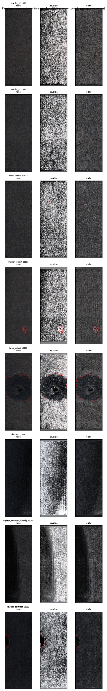
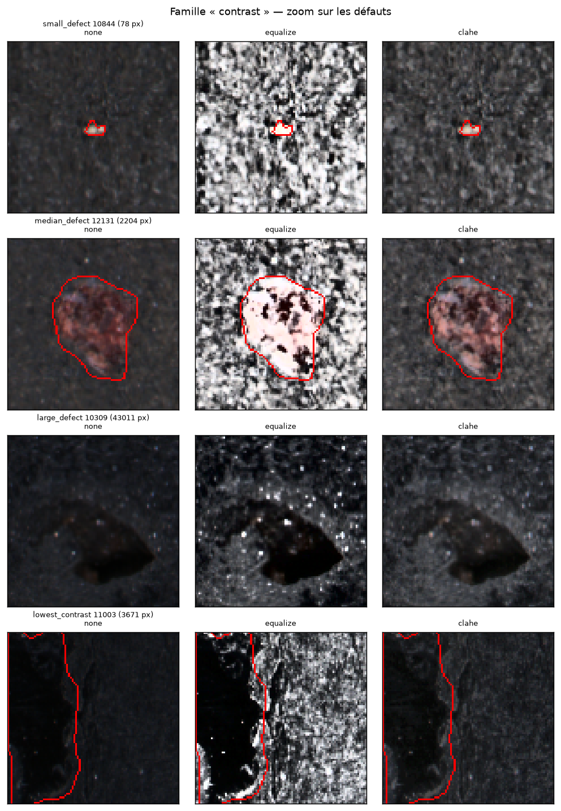
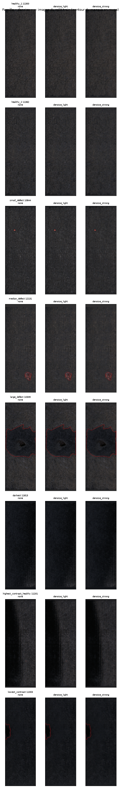
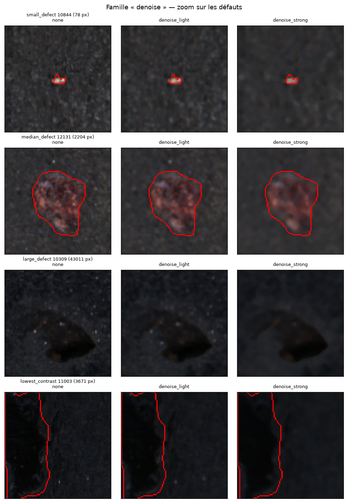
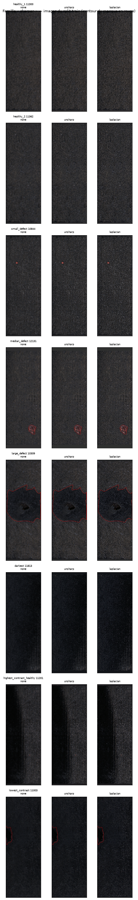
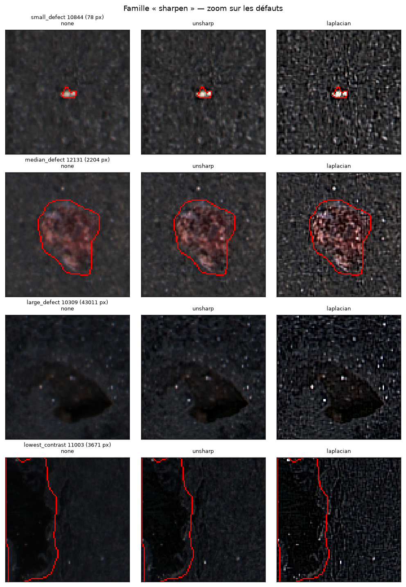
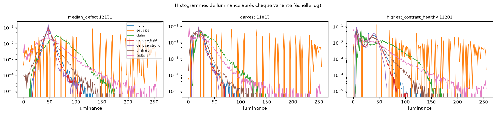
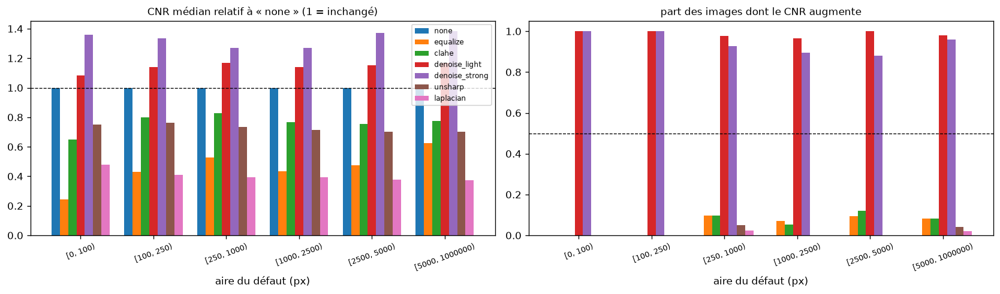
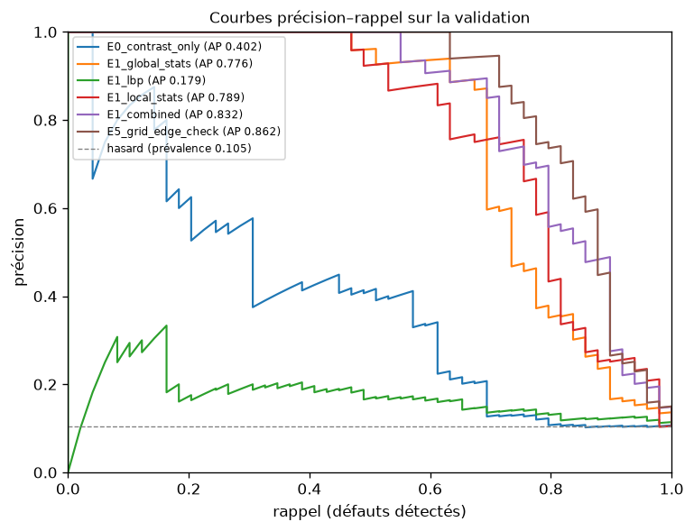

# Phase 2 — Prétraitement OpenCV et baseline classique

Généré automatiquement par `scripts/build_phase2_report.py` (config `84df535a58b1`,
seed 42). Tous les chiffres proviennent de `reports/phase2/experiments/*.json`,
`experiments.csv`, `cnr_summary.csv` ; aucun n'est saisi à la main. **Le test officiel n'a jamais
été chargé** : chaque expérience est ajustée sur le split `train` (1865 images,
197 défectueuses) et mesurée sur le split `val`
(466 images, 49 défectueuses).

## 1. Prétraitements testés

Géométrie commune (A.1) : décodage → RGB → redimensionnement à ratio conservé sur un canevas
640×224 (échelle ≈ 0,98 sur une image
native médiane 637×229 : pas de sous-échantillonnage) → padding `median`.
Les opérateurs de contraste agissent sur la luminance (canal L de LAB) pour conserver l'information
couleur ; les lissages agissent sur les trois canaux. Chaque variante est testée **séparément**.

| variante | opérateurs (ordre d'application) |
|---|---|
| none | — |
| equalize | equalize_hist() |
| clahe | clahe(clip_limit=2.0, tile_grid_size=[8, 8]) |
| denoise_light | gaussian_blur(ksize=3, sigma=0.8) |
| denoise_strong | median_blur(ksize=5) |
| unsharp | unsharp_mask(sigma=1.5, amount=1.0) |
| laplacian | laplacian_sharpen(strength=0.5) |

## 2. Résultats visuels (images du split train uniquement)

Images représentatives : healthy_1 = 11300, healthy_2 = 11362, small_defect = 10844, median_defect = 12131, large_defect = 10309, darkest = 11813, highest_contrast_healthy = 11201, lowest_contrast = 11003.

| Famille | Images complètes | Zoom sur les défauts |
|---|---|---|
| contraste (equalize vs CLAHE) |  |  |
| débruitage (léger vs fort) |  |  |
| contours (unsharp vs Laplacien) |  |  |

Histogrammes de luminance après chaque variante (la saturation et l'étalement se lisent ici) :

## 3. Effet sur les micro-défauts : CNR par taille de défaut

CNR = |moyenne(défaut) − moyenne(anneau de 6 px)| / écart-type(anneau),
calculé sur les **197 images défectueuses du train** à partir des masques,
après chaque variante (`none` = référence).

| variante | CNR médian | CNR relatif à none | part d'images améliorées | fraction saturée | écart-type médian |
|---|---|---|---|---|---|
| none | 1,631 | 1,000 | 0,000 | 0,000 | 8,726 |
| equalize | 0,780 | 0,475 | 0,081 | 0,001 | 72,208 |
| clahe | 1,212 | 0,774 | 0,081 | 0,000 | 20,469 |
| denoise_light | 1,864 | 1,156 | 0,980 | 0,000 | 7,489 |
| denoise_strong | 2,052 | 1,317 | 0,919 | 0,000 | 6,204 |
| unsharp | 1,143 | 0,717 | 0,020 | 0,000 | 12,577 |
| laplacian | 0,604 | 0,385 | 0,010 | 0,005 | 24,200 |

CNR médian relatif à `none`, par strate d'aire du défaut :

| aire du défaut (px) | n | clahe | denoise_light | denoise_strong | equalize | laplacian | none | unsharp |
|---|---|---|---|---|---|---|---|---|
| [0, 100) | 3 | 0,650 | 1,084 | 1,359 | 0,243 | 0,478 | 1,000 | 0,750 |
| [100, 250) | 6 | 0,798 | 1,142 | 1,333 | 0,430 | 0,408 | 1,000 | 0,763 |
| [250, 1000) | 41 | 0,826 | 1,167 | 1,269 | 0,529 | 0,395 | 1,000 | 0,734 |
| [1000, 2500) | 57 | 0,768 | 1,141 | 1,270 | 0,435 | 0,394 | 1,000 | 0,716 |
| [2500, 5000) | 42 | 0,753 | 1,152 | 1,373 | 0,474 | 0,378 | 1,000 | 0,702 |
| [5000, 1000000) | 48 | 0,775 | 1,169 | 1,383 | 0,627 | 0,375 | 1,000 | 0,703 |

Lecture :

- **Égalisation globale** : CNR relatif 0,47, écart-type médian ×8,3 — elle amplifie le bruit de texture au moins autant que le défaut ; les zooms le confirment (fond granuleux aussi clair que le défaut).
- **CLAHE** : CNR relatif 0,77 — plus modéré, mais toujours en dessous de l'original sur 92 % des images.
- **Débruitage** : léger 1,16, fort 1,32, y compris sur la strate des plus petits défauts (1,36 pour 3 images, effectif trop faible pour conclure seul).
- **Rehaussement des contours** : unsharp 0,72, Laplacien 0,39 — ils amplifient le bruit haute fréquence plus que le défaut.

**Mise en garde méthodologique** : le CNR récompense mécaniquement le lissage (le dénominateur, l'écart-type
de l'anneau, baisse). Il suffit à *rejeter* les transformations qui dégradent la visibilité (égalisation,
contours), pas à *retenir* le débruitage : pour cela, seule la performance du classifieur (§6, E3) compte.

## 4. Descripteurs classiques

| groupe | extracteurs | dimension |
|---|---|---|
| contrast_only | contrast_only | 1 |
| global_stats | global_stats, histogram | 46 |
| lbp | lbp | 28 |
| local_stats | local_stats | 8 |
| combined | global_stats, histogram, lbp, local_stats | 82 |

- `contrast_only` : la référence triviale de la Phase 1 (écart-type de la luminance), mesurée ici sur la validation.
- `global_stats` + `histogram` : moments, percentiles, écart entre canaux, histogramme 32 bins — la forme de la distribution des intensités.
- `lbp` : LBP uniforme invariant en rotation à (P, R) ∈ (8, 1), (16, 2) — micro-texture, invariante aux variations monotones d'éclairage (implémentation OpenCV/NumPy, testée).
- `local_stats` : grille de patches 32×32, écart-type et variance du laplacien par patch agrégés par max / p99 / écart-type / moyenne — conçu pour les défauts *locaux et petits* qu'un histogramme global dilue.

Aucune feature n'utilise de statistique de dataset : le seul objet ajusté est le `StandardScaler`, à l'intérieur du `Pipeline`, sur le train.

## 5. Baseline : protocole

`Pipeline(StandardScaler → SVC rbf)`, scores = distance signée à la marge (pas de probabilités, pas de calibration revendiquée).
Hyperparamètres C ∈ {0.1, 1.0, 10.0, 100.0} × γ ∈ {scale, 0.001, 0.01, 0.1}
choisis par **validation croisée stratifiée par groupe à 5 plis, à l'intérieur du train**, sur l'Average Precision ; le split
`val` ne sert qu'à comparer les configurations. Random Forest : 500 arbres, `class_weight=balanced`, seed 42.
Intervalles de confiance : bootstrap percentile à 95 % (1000 rééchantillonnages) sur la validation.

## 6. Métriques (validation uniquement)

| id | features | prétraitement | pad | clf | class_weight | dim | C | γ | AP CV (train) | AP val | IC 95 % AP | ROC-AUC val | préc.@R0,90 | préc.@R0,95 | FPR@R0,95 | préc.@R0,98 |
|---|---|---|---|---|---|---|---|---|---|---|---|---|---|---|---|---|
| E0_contrast_only | contrast_only | none | median | none | none | 1 | TBD | TBD | TBD | 0,402 | [0,268 ; 0,550] | 0,704 | 0,106 | 0,106 | 0,950 | 0,107 |
| E1_global_stats | global_stats | none | median | svm | balanced | 46 | 100,000 | 0.001 | 0,698 | 0,776 | [0,660 ; 0,871] | 0,901 | 0,169 | 0,155 | 0,614 | 0,136 |
| E1_lbp | lbp | none | median | svm | balanced | 28 | 10,000 | 0.001 | 0,178 | 0,179 | [0,121 ; 0,268] | 0,657 | 0,125 | 0,126 | 0,779 | 0,114 |
| E1_local_stats | local_stats | none | median | svm | balanced | 8 | 100,000 | 0.001 | 0,771 | 0,789 | [0,671 ; 0,881] | 0,921 | 0,256 | 0,235 | 0,367 | 0,105 |
| E1_combined | combined | none | median | svm | balanced | 82 | 10,000 | 0.001 | 0,777 | 0,832 | [0,732 ; 0,913] | 0,940 | 0,280 | 0,204 | 0,439 | 0,149 |
| E2_cw_none | combined | none | median | svm | none | 82 | 10,000 | 0.001 | 0,793 | 0,846 | [0,747 ; 0,925] | 0,939 | 0,251 | 0,194 | 0,468 | 0,148 |
| E2_cw_manual | combined | none | median | svm | manual | 82 | 10,000 | 0.001 | 0,786 | 0,846 | [0,748 ; 0,922] | 0,944 | 0,273 | 0,203 | 0,441 | 0,166 |
| E3_equalize | combined | equalize | median | svm | balanced | 82 | 10,000 | 0.001 | 0,683 | 0,737 | [0,616 ; 0,839] | 0,906 | 0,210 | 0,202 | 0,446 | 0,143 |
| E3_clahe | combined | clahe | median | svm | balanced | 82 | 10,000 | 0.001 | 0,791 | 0,786 | [0,674 ; 0,877] | 0,873 | 0,134 | 0,114 | 0,875 | 0,106 |
| E3_denoise_light | combined | denoise_light | median | svm | balanced | 82 | 10,000 | 0.001 | 0,788 | 0,826 | [0,715 ; 0,908] | 0,921 | 0,234 | 0,160 | 0,590 | 0,113 |
| E3_denoise_strong | combined | denoise_strong | median | svm | balanced | 82 | 10,000 | 0.001 | 0,761 | 0,809 | [0,699 ; 0,899] | 0,905 | 0,158 | 0,142 | 0,683 | 0,136 |
| E3_unsharp | combined | unsharp | median | svm | balanced | 82 | 10,000 | 0.001 | 0,757 | 0,789 | [0,677 ; 0,877] | 0,926 | 0,271 | 0,198 | 0,456 | 0,112 |
| E3_pad_zero | combined | none | zero | svm | balanced | 82 | 100,000 | 0.001 | 0,706 | 0,773 | [0,659 ; 0,870] | 0,890 | 0,172 | 0,141 | 0,688 | 0,121 |
| E4_random_forest | combined | none | median | rf | balanced | 82 | TBD | TBD | TBD | 0,805 | [0,695 ; 0,890] | 0,930 | 0,246 | 0,194 | 0,468 | 0,171 |
| E5_grid_edge_check | combined | none | median | svm | balanced | 82 | 1000,000 | 0.0001 | 0,797 | 0,862 | [0,770 ; 0,935] | 0,945 | 0,269 | 0,233 | 0,372 | 0,150 |
| E5_linear_svm | combined | none | median | svm | balanced | 82 | 0,100 | scale | 0,793 | 0,853 | [0,757 ; 0,928] | 0,943 | 0,260 | 0,237 | 0,362 | 0,131 |

### 6.1 Contrôle du signal trivial (B.3)

| Score | AP val | ROC-AUC val |
|---|---|---|
| contraste global seul (E0) | 0,402 | 0,704 |
| statistiques globales + histogramme (E1_global_stats) | 0,776 | 0,901 |
| LBP (E1_lbp) | 0,179 | 0,657 |
| statistiques locales (E1_local_stats) | 0,789 | 0,921 |
| combinées (E1_combined) | 0,832 | 0,940 |

Les descripteurs classiques combinés apportent +0,430 d'AP par rapport au contraste seul
(IC 95 % de E0 : [0,268 ; 0,550] ; de E1_combined : [0,732 ; 0,913]).
Le meilleur groupe seul est `local_stats` (AP 0,789).

### 6.2 Déséquilibre (C.2) — `class_weight` sur les features combinées, prétraitement `none`

| id | class_weight | C | γ | AP CV (train) | AP val | IC 95 % AP | ROC-AUC val | préc.@R0,95 | FPR@R0,95 |
|---|---|---|---|---|---|---|---|---|---|
| E1_combined | balanced | 10,000 | 0.001 | 0,777 | 0,832 | [0,732 ; 0,913] | 0,940 | 0,204 | 0,439 |
| E2_cw_none | none | 10,000 | 0.001 | 0,793 | 0,846 | [0,747 ; 0,925] | 0,939 | 0,194 | 0,468 |
| E2_cw_manual | manual | 10,000 | 0.001 | 0,786 | 0,846 | [0,748 ; 0,922] | 0,944 | 0,203 | 0,441 |

`manual` = `{1: 3.0}` est une **expérience exploratoire** (≈ racine du ratio de déséquilibre), pas un coût métier :
le ratio de coût réel n'est pas connu et le levier des coûts reste le seuil (Phase 4).

### 6.3 Contrôle de bord de grille et noyau

| id | C | γ | AP CV (train) | AP val | IC 95 % AP | ROC-AUC val | préc.@R0,95 | FPR@R0,95 |
|---|---|---|---|---|---|---|---|---|
| E1_combined | 10,000 | 0.001 | 0,777 | 0,832 | [0,732 ; 0,913] | 0,940 | 0,204 | 0,439 |
| E5_grid_edge_check | 1000,000 | 0.0001 | 0,797 | 0,862 | [0,770 ; 0,935] | 0,945 | 0,233 | 0,372 |
| E5_linear_svm | 0,100 | scale | 0,793 | 0,853 | [0,757 ; 0,928] | 0,943 | 0,237 | 0,362 |

Dans toutes les expériences RBF de la grille validée, la CV a sélectionné γ = 0,001, c'est-à-dire
la **borne inférieure** de la grille. E5_grid_edge_check étend la grille vers le bas : la CV choisit
à nouveau le coin (C = 1000, γ = 0.0001).
Un noyau RBF à γ → 0 et C grand tend vers un séparateur linéaire ; E5_linear_svm le vérifie avec un
noyau linéaire (C = 0,10, optimum intérieur à la grille) et obtient une AP équivalente.
Les IC de ces trois configurations se recouvrent : les descripteurs classiques sont séparés de façon
essentiellement linéaire, et le noyau RBF n'apporte rien de mesurable.

### 6.4 Compromis de seuil pour la meilleure configuration (E5_grid_edge_check)

| rappel cible | seuil (score) | rappel obtenu | précision | FPR | TP | FP | FN | TN |
|---|---|---|---|---|---|---|---|---|
| 0,900 | -0,934 | 0,918 | 0,269 | 0,293 | 45 | 122 | 4 | 295 |
| 0,950 | -1,081 | 0,959 | 0,233 | 0,372 | 47 | 155 | 2 | 262 |
| 0,980 | -1,538 | 1,000 | 0,150 | 0,667 | 49 | 278 | 0 | 139 |
| 0,990 | -1,538 | 1,000 | 0,150 | 0,667 | 49 | 278 | 0 | 139 |

Au seuil par défaut du classifieur : précision 0,661, rappel 0,837, F1 0,739 —
rapporté pour information, ce n'est pas un point de fonctionnement retenu.

## 7. Limites

- 49 défectueuses en validation : les IC bootstrap sont larges ; deux configurations dont les IC se recouvrent ne sont pas départagées.
- 16 configurations comparées sur la même validation → le meilleur chiffre est légèrement optimiste (sélection). Le chiffre non biaisé viendra du test officiel en Phase 4.
- Les scores SVM ne sont pas des probabilités : les seuils du §6.4 sont des seuils de score.
- Le CNR favorise le lissage par construction (§3).
- Les strates de petits défauts contiennent peu d'images ([0, 100) : 3, [100, 250) : 6).

## 8. Choix retenus (règles appliquées aux chiffres)

- Référence classique pour la comparaison avec le CNN : `E5_grid_edge_check` — features `combined`, prétraitement `none`, AP val 0,862, IC [0,770 ; 0,935], ROC-AUC 0,945.
- Prétraitement : meilleure variante E3 = `none` (AP 0,832) ; gains significatifs (IC disjoints de `none`) : aucun.
  Aucune variante ne bat `none` de façon significative : la valeur `active` reste `none` pour la Phase 3, le CNN apprenant lui-même sa normalisation de contraste.
- Padding : `median` vs `zero` → AP 0,832 vs 0,773 (IC recouvrants).

## 9. Choix rejetés

- Égalisation globale et rehaussement des contours (unsharp, Laplacien) : CNR relatif < 1 sur toutes les strates (§3) et AP val inférieure à `none` (§6).
- GLCM : non ajouté (LBP couvre la micro-texture ; décision validée).
- Empilement de transformations : aucune combinaison n'a été construite, faute de gain individuel significatif à combiner.

## 10. Implications pour la Phase 3

- La référence à battre sur la **validation** est l'AP 0,862 (IC [0,770 ; 0,935]) de `E5_grid_edge_check`, et non l'AP 0,402 du contraste seul. Un CNN dont l'AP de validation reste sous 0,935 n'apporte rien de démontrable avec 49 positifs.
- Le coût du rappel élevé est le vrai problème de la baseline : à rappel 0,95, précision 0,233 et FPR 0,372 — il faudrait réinspecter ~37 % des pièces saines. C'est l'axe sur lequel le CNN doit apporter sa valeur.
- Les descripteurs classiques sont quasi linéairement séparables (§6.3) : le gain attendu du CNN vient de sa capacité à *localiser* (convolutions) plutôt que d'une non-linéarité sur des statistiques globales.
- Prétraitement du CNN : `none` (§8) ; l'augmentation luminosité/contraste doit rester légère (§2, images sombres et peu contrastées).
- Déséquilibre : voir §6.2 pour l'effet de `class_weight` sur la baseline ; la décision pour le CNN reste ouverte (ablation `pos_weight` en Phase 4).
