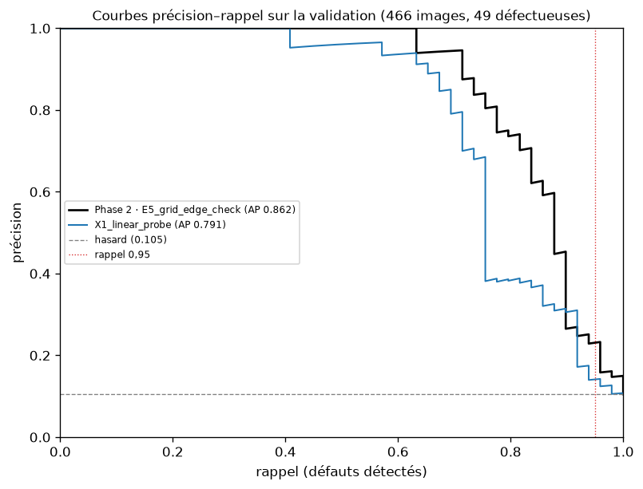
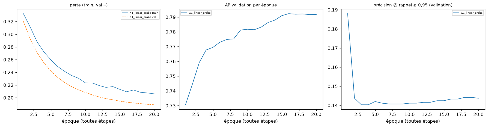

# Phase 3 — Résultats CNN (validation uniquement)

Généré par `scripts/build_phase3_report.py` (config `45ede5e751b2`, seed 42). Chaque chiffre
provient de `reports/phase3/experiments/*.json` ; le test officiel n'a été chargé par aucun run
(`test_used = false` dans chaque JSON). Validation : 466 images dont 49 défectueuses — un écart de
quelques centièmes n'est pas interprétable ; les IC bootstrap et le bootstrap **apparié** contre la référence
Phase 2 (`E5_grid_edge_check`, AP 0,862) sont la seule base de comparaison.

## 1. Comparaison avec la référence Phase 2

| modèle | AP | IC 95 % AP | préc.@R0,90 | préc.@R0,95 | FPR@R0,95 | préc.@R0,98 | ROC-AUC | ΔAP apparié [IC] | Δpréc.@0,95 apparié [IC] |
|---|---|---|---|---|---|---|---|---|---|
| Phase 2 · E5_grid_edge_check | 0,862 | [0,770 ; 0,935] | 0,269 | 0,233 | 0,372 | 0,150 | 0,945 | — | — |
| X1_linear_probe | 0,791 | [0,679 ; 0,878] | 0,310 | 0,142 | 0,679 | 0,108 | 0,906 | -0,071 [-0,164 ; 0,013] | -0,090 [-0,469 ; 0,175] |

## 2. Courbes d'entraînement

## X1_linear_probe

Recette : étapes A, `pos_weight` = 1.0 (1,00),
sampler `none`, pooling `avg`, batch 16, workers 2,
biais initial de la tête TBD = log(n_pos/n_neg) = log(197/1668).
Run `20260916_152506_X1_linear_probe_45ede5e751b2` — commit `7c48a28e1abe649f382957f052d8cb2d20d1b5a1`, config `45ede5e751b2`, torch 2.14.0+cpu,
durée totale 7,1 min, `test_used = false`.

| étape | entraînable | LR | époques | meilleure | AP val (best) | arrêt anticipé | durée (s) | features gelées (s) |
|---|---|---|---|---|---|---|---|---|
| A | 513 | {"head": 0.001} | 20 | 15 | 0,791 | True | 341,047 | 336,376 |

Évolution par époque :

| stage | epoch | train_loss | val_loss | val_average_precision | val_precision_r095 | val_fpr_r095 | mean_val_prob | seconds |
|---|---|---|---|---|---|---|---|---|
| A | 1 | 0,3325 | 0,3203 | 0,7306 | 0,1880 | 0,4868 | 0,1235 | 0,0821 |
| A | 2 | 0,3111 | 0,2924 | 0,7445 | 0,1437 | 0,6715 | 0,1158 | 0,0702 |
| A | 3 | 0,2879 | 0,2709 | 0,7592 | 0,1403 | 0,6906 | 0,0993 | 0,0665 |
| A | 4 | 0,2719 | 0,2548 | 0,7677 | 0,1403 | 0,6906 | 0,1099 | 0,1336 |
| A | 5 | 0,2597 | 0,2418 | 0,7695 | 0,1420 | 0,6811 | 0,1170 | 0,0784 |
| A | 6 | 0,2490 | 0,2319 | 0,7730 | 0,1411 | 0,6859 | 0,1167 | 0,0723 |
| A | 7 | 0,2415 | 0,2237 | 0,7748 | 0,1407 | 0,6882 | 0,1143 | 0,0760 |
| A | 8 | 0,2351 | 0,2175 | 0,7752 | 0,1407 | 0,6882 | 0,1145 | 0,0739 |
| A | 9 | 0,2307 | 0,2126 | 0,7812 | 0,1407 | 0,6882 | 0,1137 | 0,0802 |
| A | 10 | 0,2234 | 0,2083 | 0,7818 | 0,1411 | 0,6859 | 0,1105 | 0,0703 |
| A | 11 | 0,2233 | 0,2045 | 0,7814 | 0,1411 | 0,6859 | 0,1126 | 0,0747 |
| A | 12 | 0,2192 | 0,2012 | 0,7832 | 0,1416 | 0,6835 | 0,1117 | 0,0893 |
| A | 13 | 0,2163 | 0,1987 | 0,7863 | 0,1416 | 0,6835 | 0,1116 | 0,0735 |
| A | 14 | 0,2176 | 0,1967 | 0,7880 | 0,1424 | 0,6787 | 0,1155 | 0,0894 |
| A | 15 | 0,2132 | 0,1946 | 0,7910 | 0,1424 | 0,6787 | 0,1098 | 0,0677 |
| A | 16 | 0,2094 | 0,1930 | 0,7923 | 0,1433 | 0,6739 | 0,1101 | 0,0845 |
| A | 17 | 0,2122 | 0,1918 | 0,7920 | 0,1433 | 0,6739 | 0,1079 | 0,0749 |
| A | 18 | 0,2085 | 0,1907 | 0,7921 | 0,1442 | 0,6691 | 0,1118 | 0,0774 |
| A | 19 | 0,2075 | 0,1897 | 0,7917 | 0,1442 | 0,6691 | 0,1097 | 0,0729 |
| A | 20 | 0,2062 | 0,1889 | 0,7918 | 0,1437 | 0,6715 | 0,1105 | 0,0848 |

**Métriques finales (validation)** : AP 0,791 [0,679 ; 0,878],
ROC-AUC 0,906 [0,839 ; 0,959], perte val 0,1946,
probabilité moyenne prédite 0,111 (prévalence 0,105).

| rappel cible | seuil (prob.) | rappel obtenu | précision | FPR | TP | FP | FN | TN |
|---|---|---|---|---|---|---|---|---|
| 0,900 | 0,089 | 0,918 | 0,310 | 0,240 | 45 | 100 | 4 | 317 |
| 0,950 | 0,049 | 0,959 | 0,142 | 0,679 | 47 | 283 | 2 | 134 |
| 0,980 | 0,028 | 1,000 | 0,108 | 0,974 | 49 | 406 | 0 | 11 |
| 0,990 | 0,028 | 1,000 | 0,108 | 0,974 | 49 | 406 | 0 | 11 |

Au seuil 0,5 (rapporté, non retenu) : précision 0,952, rappel 0,408, F1 0,571,
TP 20 / FP 1 / FN 29 / TN 416.

Rappel par taille de défaut au seuil « rappel ≥ 0,95 » :

| area_bin | n_positives | recall | missed |
|---|---|---|---|
| [0, 250) | 5 | 1,000 | 0 |
| [250, 1000) | 10 | 0,800 | 2 |
| [1000, 2500) | 9 | 1,000 | 0 |
| [2500, 5000) | 11 | 1,000 | 0 |
| [5000, 1000000) | 14 | 1,000 | 0 |

Comparaison appariée avec `E5_grid_edge_check` (1000 rééchantillonnages) : ΔAP -0,071
[-0,164 ; 0,013] ; Δprécision@0,95 -0,090
[-0,469 ; 0,175] ; ΔFPR@0,95 0,307
[-0,396 ; 0,705]. Un IC de Δ contenant 0 = non départageable avec 49 positifs.
