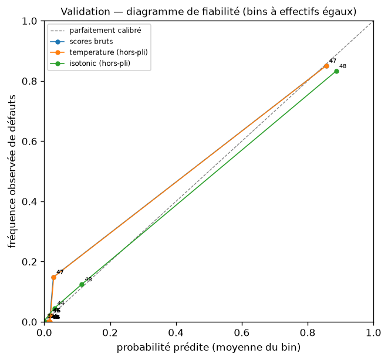
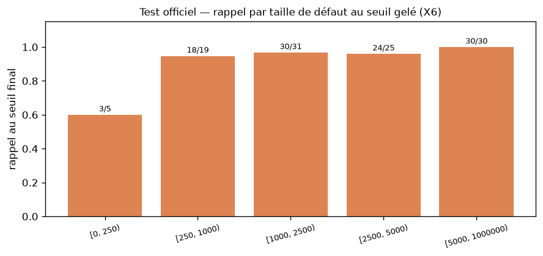
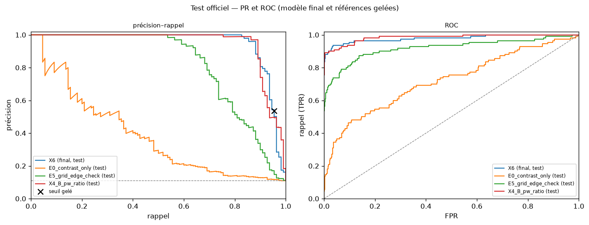
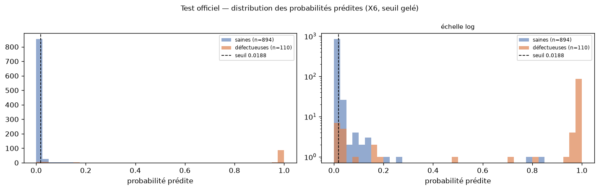
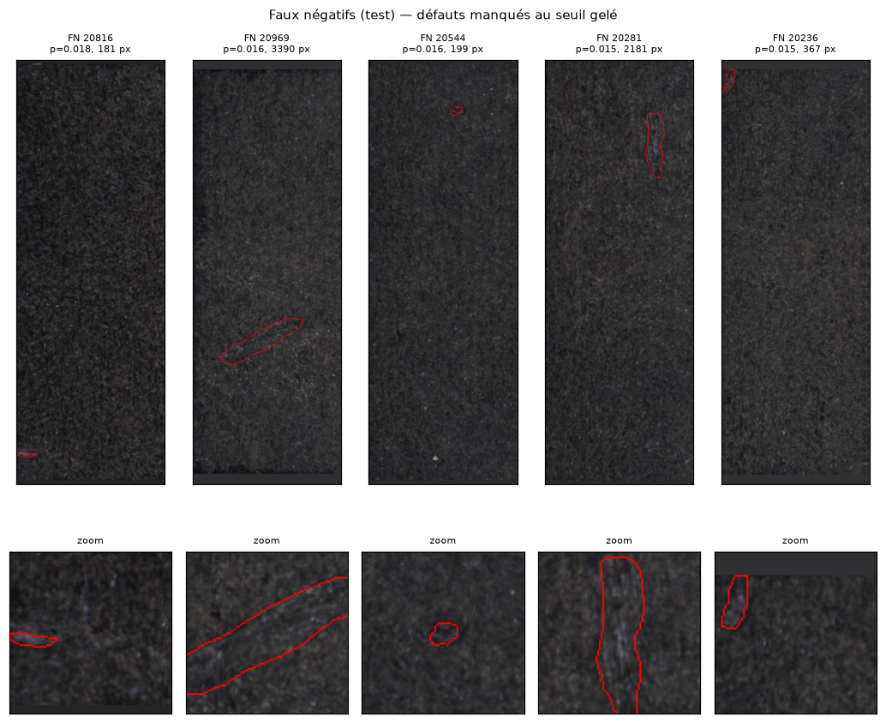
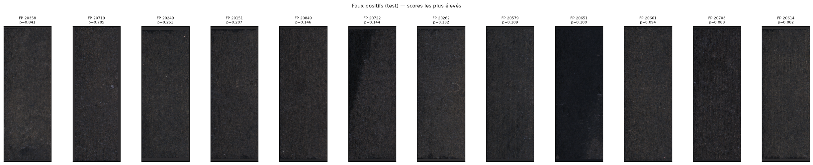
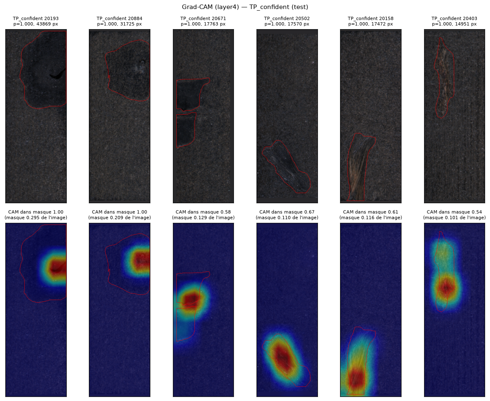
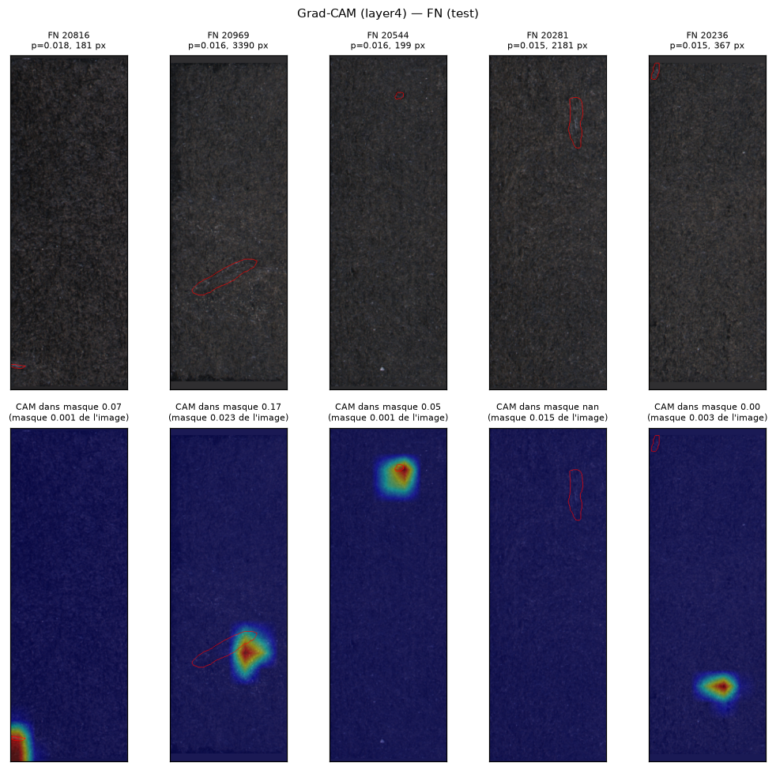
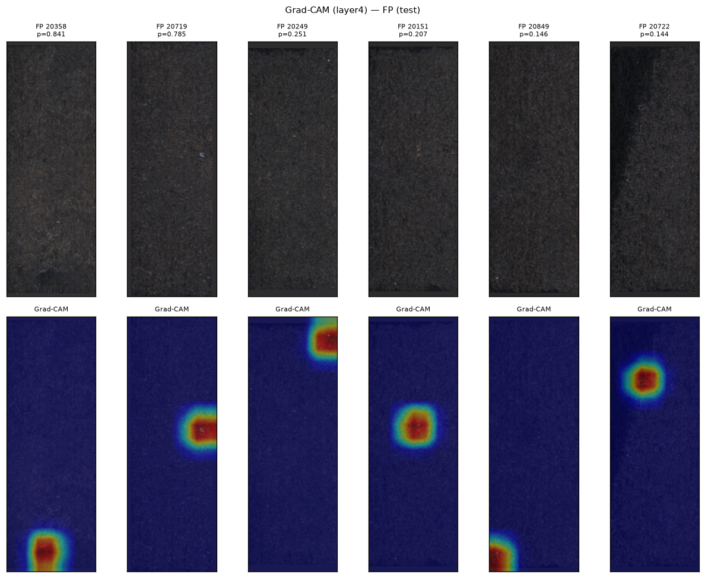

# Phase 4 — Modèle final, seuil et évaluation unique du test officiel

Généré par `scripts/build_phase4_report.py` (config `f9397663b72a`). Chaque chiffre provient de
`reports/phase4/*.json`, `models/final/*.json` et des JSON des phases 2–3 ; rien n'est saisi à la main.
**Le test officiel a été évalué une seule fois**, le 2026-09-17 16:09:09 UTC, après le gel du modèle,
du prétraitement et du seuil (2026-09-17 15:26:49 UTC). Aucune décision n'a été prise à partir du test.

## 4.1 Objectif

Transformer le candidat X6 (Phase 3) en système final de classification binaire sain / défectueux :
vérification du checkpoint, analyse et calibration des scores sur la validation, sélection et gel du seuil,
puis évaluation finale unique sur le test officiel KolektorSDD2, analyse des erreurs et Grad-CAM.

## 4.2 Modèle final (gelé)

| Élément | Valeur |
|---|---|
| Architecture | ResNet-18 ImageNet (`18eed599c81b`), pooling `avg`, tête Dropout 0,2 + Linear(512→1) — 11,177,025 paramètres |
| Recette | A (linear probe) -> B (layer4+head, X4) -> C (layer3+layer4+head) ; `pos_weight` 8,467 ; sampler none ; BN `all_eval` ; AdamW wd 1e-4 ; LR C {"layer3": 5e-05, "layer4": 0.0001, "head": 0.0005} ; batch 16 ; seed 42 |
| Checkpoint | `runs\20260917_002044_X6_C_winner_18eed599c81b\stage_C_best.pt` — étape C, époque 5, AP val 0,9408 (critère préenregistré), commit d'entraînement `5b62df4` |
| Bundle | `models/final/` : `model.pt` (SHA-256 `4233a9cd80534b8e…`, copie octet à octet du checkpoint), `preprocessor.json`, `threshold.json`, `model_card.json`, `final_test_metrics.json` |
| Prétraitement | {"input_size": [640, 224], "resize_mode": "keep_aspect_pad", "pad_value": "median", "interpolation": "area", "color_mode": "rgb", "variant": "none", "steps": [], "normalization": {"mean": [0.485, 0.456, 0.406], "std": [0.229, 0.224, 0.225]}} |
| Vérification | métadonnées = résultat X6 ; deux passes val identiques ; écart max vs scores enregistrés 9.9e-17 ; AP reproduite 0,9408 |

## 4.3 Sélection du seuil (validation uniquement)

Contrainte de développement : rappel ≥ 0.95 ; contrainte métier : un défaut manqué coûte plus qu'une fausse alerte.
Règle préenregistrée (config, avant l'analyse) : `min_recall` — seuil le moins permissif atteignant le rappel cible sur la
validation (0,01974, 47/49) — puis **marge** `midpoint_logit` : milieu, en logit, entre ce score et celui du positif
suivant (0,01781) → **seuil gelé 0,018752**. La marge protège d'une dérive des scores sur de
nouvelles pièces ; elle coûte 16 faux positifs sur la validation pour le même rappel.

Candidats autour de la contrainte (un seuil par score de positif ; le coût attendu, à titre d'information, minimise
(FN × ratio + FP)/N pour des ratios de coût **inconnus** en pratique) :

| positifs gardés | seuil | tp | fp | fn | recall | precision | fpr | coût/img (FN=5×FP) | coût/img (FN=10×FP) | coût/img (FN=20×FP) |
|---|---|---|---|---|---|---|---|---|---|---|
| 10 | 0,0297 | 44 | 14 | 5 | 0,8980 | 0,7586 | 0,0336 | 0,0837 | 0,1373 | 0,2446 |
| 11 | 0,0286 | 45 | 14 | 4 | 0,9184 | 0,7627 | 0,0336 | 0,0730 | 0,1159 | 0,2017 |
| 12 | 0,0271 | 46 | 14 | 3 | 0,9388 | 0,7667 | 0,0336 | 0,0622 | 0,0944 | 0,1588 |
| 13 | 0,0197 | 47 | 35 | 2 | 0,9592 | 0,5732 | 0,0839 | 0,0966 | 0,1180 | 0,1609 |
| 14 | 0,0178 | 48 | 60 | 1 | 0,9796 | 0,4444 | 0,1439 | 0,1395 | 0,1502 | 0,1717 |
| 15 | 0,0169 | 49 | 92 | 0 | 1,0000 | 0,3475 | 0,2206 | 0,1974 | 0,1974 | 0,1974 |

Lecture : le point de coût minimal pour tout ratio 5–20 est le rang 12 (46/49, rappel 0,939), *sous* la contrainte de rappel ;
la contrainte prime par construction. Le seuil choisi n'a pas été retenu pour sa précision : c'est l'application de la règle
fixée avant de voir ces chiffres.

| jeu | seuil | rappel | précision | FPR | F1 | TP | FP | FN | TN | IC rappel | IC précision | IC FPR |
|---|---|---|---|---|---|---|---|---|---|---|---|---|
| validation, seuil min_recall | 0,020 | 0,959 | 0,573 | 0,084 | 0,718 | 47 | 35 | 2 | 382 | n/d | n/d | n/d |
| validation, seuil gelé | 0,019 | 0,959 | 0,480 | 0,122 | 0,639 | 47 | 51 | 2 | 366 | [0,898 ; 1,000] | [0,382 ; 0,576] | [0,093 ; 0,153] |

## 4.4 Calibration

Le modèle a été entraîné avec `pos_weight` = 8,47 : ses sorties ne sont pas des probabilités calibrées par construction,
et le seuil 0,5 n'a aucun statut particulier. Diagnostics sur la validation (n = 466, 49 positives) :

| scores | ECE (effectifs égaux) | ECE (largeurs égales) | Brier | NLL | paramètres |
|---|---|---|---|---|---|
| bruts | 0,0223 | 0,0055 | 0,0200 | 0,0875 | — |
| temperature (hors-pli, 5 plis sur val) | 0,0225 | 0,0048 | 0,0200 | 0,0878 | {"temperature": 1.0132792513994968} |
| isotonic (hors-pli, 5 plis sur val) | 0,0102 | 0,0087 | 0,0188 | 0,0919 | {"n_knots": 12} |

Diagramme de fiabilité (bins à effectifs égaux, scores bruts) :

| bin | n | prob. prédite (moy.) | fréquence observée |
|---|---|---|---|
| 0 | 47 | 0,0121 | 0,0000 |
| 1 | 46 | 0,0139 | 0,0000 |
| 2 | 47 | 0,0145 | 0,0000 |
| 3 | 46 | 0,0149 | 0,0000 |
| 4 | 47 | 0,0154 | 0,0000 |
| 5 | 46 | 0,0159 | 0,0000 |
| 6 | 47 | 0,0165 | 0,0213 |
| 7 | 46 | 0,0176 | 0,0217 |
| 8 | 47 | 0,0278 | 0,1489 |
| 9 | 47 | 0,8565 | 0,8511 |

Décision : **scores bruts conservés** — règle : keep raw scores if raw ECE (equal-mass bins) < 0.1 ; ECE brut 0,022, température ajustée
1,013 (≈ identité, aucun bénéfice), isotonique : gain hors-pli marginal pour 49 positifs
et ECE in-sample nul (surajustement). Point à retenir pour l'exploitation : dans la bande de scores autour du seuil
(≈ 0,02–0,03), la fréquence observée de défauts est ≈ 15 % — le seuil ne se lit pas comme « 2 % de probabilité ».
Toute calibration monotone laisserait le point de fonctionnement inchangé (même classement).

## 4.5 Résultats validation (développement — modèle et seuil choisis dessus, chiffres optimistes)

AP 0,941 [0,891 ; 0,979] · ROC-AUC 0,987 [0,974 ; 0,997].

| modèle | AP | IC AP | ROC-AUC | préc.@R0,95 | FPR@R0,95 | rappel@R0,95 |
|---|---|---|---|---|---|---|
| E0 contraste seul | 0,402 | [0,268 ; 0,550] | 0,704 | 0,106 | 0,950 | 0,959 |
| E5 SVM (Phase 2) | 0,862 | [0,770 ; 0,935] | 0,945 | 0,233 | 0,372 | 0,959 |
| X4 étape B | 0,919 | [0,848 ; 0,976] | 0,968 | 0,251 | 0,336 | 0,959 |
| X6_C_winner (candidat) | 0,941 | [0,891 ; 0,979] | 0,987 | 0,573 | 0,084 | 0,959 |

Figures : `figures/val_score_distribution.png`, `figures/val_pr_roc.png`, `figures/val_metrics_vs_threshold.png`.

## 4.6 Résultats du test officiel (finaux — évaluation unique)

Test officiel KolektorSDD2 : 1004 images, 110 défectueuses, 894 saines. Modèle final gelé, seuil gelé 0,018752.

| Métrique | Valeur | IC 95 % bootstrap |
|---|---|---|
| AP | **0,948** | [0,909 ; 0,977] |
| ROC-AUC | 0,979 | [0,959 ; 0,994] |
| Rappel au seuil gelé | **0,955** (105/110) | [0,907 ; 0,991] |
| Précision au seuil gelé | 0,536 | [0,464 ; 0,603] |
| FPR au seuil gelé | 0,102 | [0,083 ; 0,121] |
| F1 / F2 au seuil gelé | 0,686 / 0,825 | — |
| Matrice de confusion | TP 105 · FP 91 · FN **5** · TN 803 | — |
| Exactitude (rapportée, non utilisée) | 0,904 | — |

Points de fonctionnement *a posteriori* sur le test (information seulement — le seuil gelé est le seul point de décision) :

| rappel cible | seuil | rappel | précision | FPR | TP | FP | FN |
|---|---|---|---|---|---|---|---|
| 0,9000 | 0,0398 | 0,9000 | 0,8609 | 0,0179 | 99 | 16 | 11 |
| 0,9500 | 0,0189 | 0,9545 | 0,5440 | 0,0984 | 105 | 88 | 5 |
| 0,9800 | 0,0160 | 0,9818 | 0,2547 | 0,3535 | 108 | 316 | 2 |
| 0,9900 | 0,0151 | 0,9909 | 0,1747 | 0,5761 | 109 | 515 | 1 |

Rappel par taille de défaut au seuil gelé :

| aire (px) | défauts | rappel | manqués |
|---|---|---|---|
| [0, 250) | 5 | 0,600 | 2 |
| [250, 1000) | 19 | 0,947 | 1 |
| [1000, 2500) | 31 | 0,968 | 1 |
| [2500, 5000) | 25 | 0,960 | 1 |
| [5000, 1000000) | 30 | 1,000 | 0 |

Cohérence validation → test au seuil gelé : rappel 0,959 → 0,955, précision
0,480 → 0,536, FPR 0,122 → 0,102, AP 0,941 → 0,948.

## 4.7 Analyse des erreurs (test)

**Faux négatifs (5)** — tous ont un score compris entre 0,0148 et 0,0185,
juste sous le seuil 0,0188 :

| image_id | probabilité | aire (px) | boîte L | boîte H | contraste image |
|---|---|---|---|---|---|
| 20816 | 0,0185 | 181,0000 | 29,0000 | 9,0000 | 10,1940 |
| 20969 | 0,0163 | 3390,0000 | 127,0000 | 71,0000 | 10,0640 |
| 20544 | 0,0160 | 199,0000 | 17,0000 | 15,0000 | 7,8710 |
| 20281 | 0,0151 | 2181,0000 | 29,0000 | 100,0000 | 8,9760 |
| 20236 | 0,0148 | 367,0000 | 16,0000 | 32,0000 | 8,9370 |

Médianes FN vs TP : aire 367 px vs 2535 px ; boîte 29×32 vs
69×70 ; contraste image 9,0 vs 9,8.
Observations (aucune conclusion causale) : les défauts manqués **semblent associés** à une petite aire (2 des 5 FN sont dans la
strate < 250 px, où le rappel tombe à 0,60), à un faible contraste local (deux défauts étendus mais très pâles,
20969 et 20281) et, pour deux d'entre eux (20816, 20236), à une position en bordure d'image. Hypothèse : à la résolution de `layer4`
(cellules ≈ 32×32 px), un défaut de quelques dizaines de pixels et peu contrasté n'active pas assez la carte.

**Faux positifs (91)** — médiane des scores 0,024, 90 % sous 0,094 ;
seulement 2 au-dessus de 0,5. Ce sont donc essentiellement des images saines poussées au-dessus d'un seuil très bas par
la contrainte de rappel, pas des erreurs confiantes. Médianes FP vs TN : luminance 44,1 vs 44,6,
contraste 9,12 vs 8,97, écart entre canaux 3,76 vs 3,81 —
aucun motif photométrique global ne distingue les FP (cohérent avec la Phase 1 : la séparabilité triviale est faible).

| image_id | probabilité | luminance | contraste |
|---|---|---|---|
| 20358 | 0,841 | 49,977 | 9,187 |
| 20719 | 0,785 | 45,620 | 8,456 |
| 20249 | 0,251 | 44,786 | 8,479 |
| 20151 | 0,207 | 43,209 | 8,614 |
| 20849 | 0,146 | 41,451 | 8,375 |
| 20722 | 0,144 | 37,164 | 11,947 |
| 20262 | 0,132 | 48,346 | 9,448 |
| 20579 | 0,109 | 42,307 | 8,113 |
| 20651 | 0,100 | 26,265 | 6,044 |
| 20661 | 0,094 | 45,109 | 8,161 |

## 4.8 Grad-CAM (layer4)

| catégorie | n | masse CAM dans le masque (médiane) | concentration (masse/aire relative) | pic dans le masque |
|---|---|---|---|---|
| TP_confident | 6 | 0,64 | 5,02 | 1,00 |
| TP_borderline | 6 | 0,16 | 24,18 | 0,17 |
| FN | 4 | 0,06 | 24,63 | 0,00 |

Lecture : quand le modèle est **confiant** (p ≈ 1), le pic de la carte est dans le masque pour 100 % des exemples et
64 % de la masse de la carte tombe dans le défaut — le réseau regarde bien la région annotée.
Pour les vrais positifs **limites** et les faux négatifs, la carte est diffuse (pic hors masque) : la décision repose sur peu d'évidence localisée.
Limites : résolution d'une cellule ≈ 32×32 px ; carte de sensibilité du logit, pas une segmentation ; dépend de la couche choisie ; ne dit rien de la calibration.

## 4.9 Comparaison finale

Validation (développement, 49 positives) :

| modèle | AP | IC AP | ROC-AUC | préc.@R0,95 | FPR@R0,95 | rappel@R0,95 |
|---|---|---|---|---|---|---|
| E0 contraste seul | 0,402 | [0,268 ; 0,550] | 0,704 | 0,106 | 0,950 | 0,959 |
| E5 SVM (Phase 2) | 0,862 | [0,770 ; 0,935] | 0,945 | 0,233 | 0,372 | 0,959 |
| X4 étape B | 0,919 | [0,848 ; 0,976] | 0,968 | 0,251 | 0,336 | 0,959 |
| X6_C_winner (candidat) | 0,941 | [0,891 ; 0,979] | 0,987 | 0,573 | 0,084 | 0,959 |

Test officiel (passe unique ; les trois références sont des modèles gelés scorés dans la même passe, sans aucune décision) :

| modèle | AP | IC AP | ROC-AUC | préc.@R0,95 | FPR@R0,95 | ΔAP (X6 − modèle) [IC] | Δpréc.@0,95 (X6 − modèle) [IC] |
|---|---|---|---|---|---|---|---|
| E0 contraste seul | 0,384 | [0,295 ; 0,484] | 0,720 | 0,118 | 0,878 | 0,564 [0,469 ; 0,653] | 0,426 [0,117 ; 0,757] |
| E5 SVM (Phase 2) | 0,814 | [0,747 ; 0,870] | 0,920 | 0,171 | 0,569 | 0,133 [0,089 ; 0,191] | 0,373 [0,045 ; 0,677] |
| X4 étape B | 0,947 | [0,907 ; 0,975] | 0,984 | 0,498 | 0,119 | 0,001 [-0,022 ; 0,024] | 0,046 [-0,267 ; 0,340] |
| **X6_C_winner — modèle final gelé** | 0,948 | [0,909 ; 0,977] | 0,979 | 0,544 | 0,098 | — | — |

Lecture prudente : face à la SVM classique : ΔAP 0,133 [0,089 ; 0,191] (IC apparié de ΔAP excluant 0) ; face au contraste seul : ΔAP 0,564 [0,469 ; 0,653] (IC apparié de ΔAP excluant 0) ; face à X4 (étape B) : ΔAP 0,001 [-0,022 ; 0,024] — X6_C_winner et X4 sont **indissociables** sur le test ; l'étape C n'apporte pas de gain démontré, alors que la validation le suggérait.

## 4.10 Limites

- 110 défauts dans le test, 49 en validation : IC larges ; le rappel au seuil gelé est 0,955 avec un IC [0,907 ; 0,991].
- Modèle, checkpoint et seuil sélectionnés sur la validation : les chiffres de validation sont optimistes par construction ; seul le test est non biaisé, et il n'a servi à aucune décision.
- Les petits défauts (< 250 px) restent le point faible (rappel 0,60 sur 5 cas).
- Domaine spécifique (commutateurs KolektorSDD2, éclairage fixe) : aucune garantie de généralisation à une autre ligne, un autre produit ou un autre capteur sans nouvelle validation.
- Calibration imparfaite dans la bande utile (scores bruts, `pos_weight` 8,5) ; les probabilités ne sont pas des probabilités métier.
- Coût CPU élevé : ≈ 164 ms par image en inférence sur l'i7-8665U (prétraitement inclus), ≈ 1 h par époque d'entraînement en étape C.
- Grad-CAM : évidence qualitative à résolution grossière, pas une localisation.
- La provenance du run de test porte `git_dirty = true` : au lancement le working tree était propre au commit `7ade5da` ; le drapeau reflète les fichiers de sortie que le script lui-même écrit avant d'enregistrer sa provenance.

## 4.11 Reproductibilité

| Élément | Valeur |
|---|---|
| Commit du gel / de l'évaluation | `7ade5da` |
| Config au gel | `f9397663b72a` ; config d'entraînement du checkpoint `18eed599c81b` |
| Seed | 42 |
| Checkpoint | `runs\20260917_002044_X6_C_winner_18eed599c81b\stage_C_best.pt` — SHA-256 `4233a9cd80534b8efd20cb9abccb772911c9a7c8eb1cbba24fd27845b14e0cbb` |
| Prétraitement | `models/final/preprocessor.json` (variante `none`, padding `median`, 640×224) |
| Seuil final | 0,018752 (`models/final/threshold.json`, `frozen = true`, gelé le 2026-09-17 15:26:49 UTC) |
| Test officiel | évalué une fois le 2026-09-17 16:09:09 UTC ; `test_used = true` uniquement dans `test_evaluation.json`, `error_analysis.json` et `final_test_metrics.json` |
| Commandes | `python scripts/verify_checkpoint.py` → `python scripts/select_threshold.py --freeze` → `python scripts/evaluate_test.py` → `python scripts/build_phase4_report.py` |
